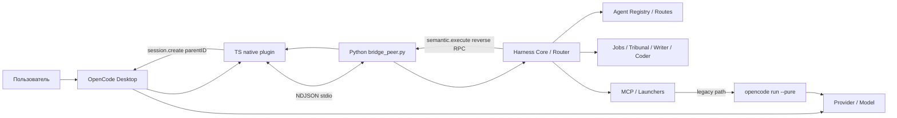
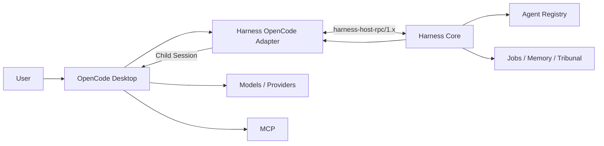
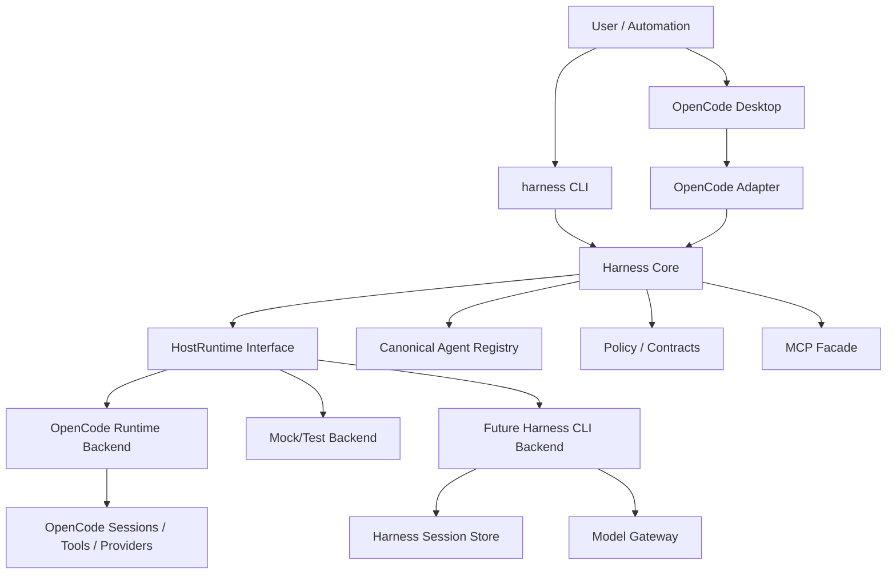
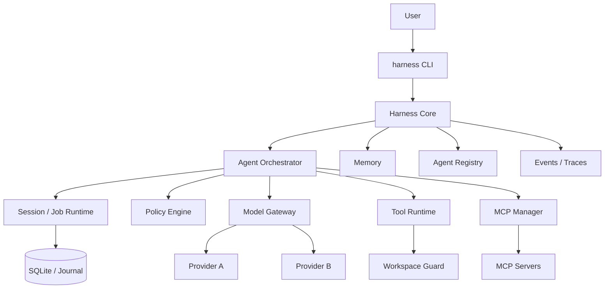
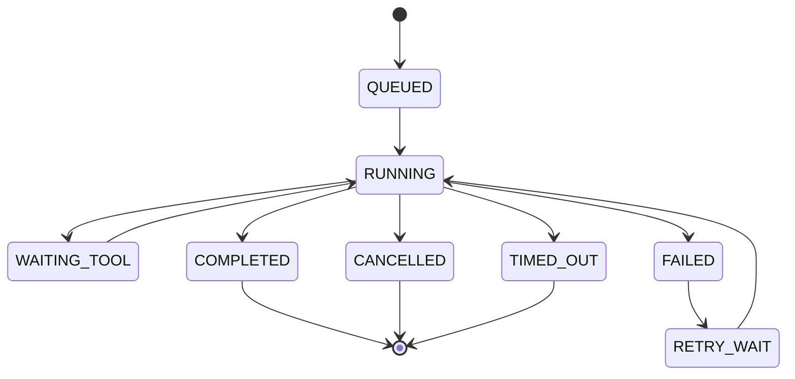
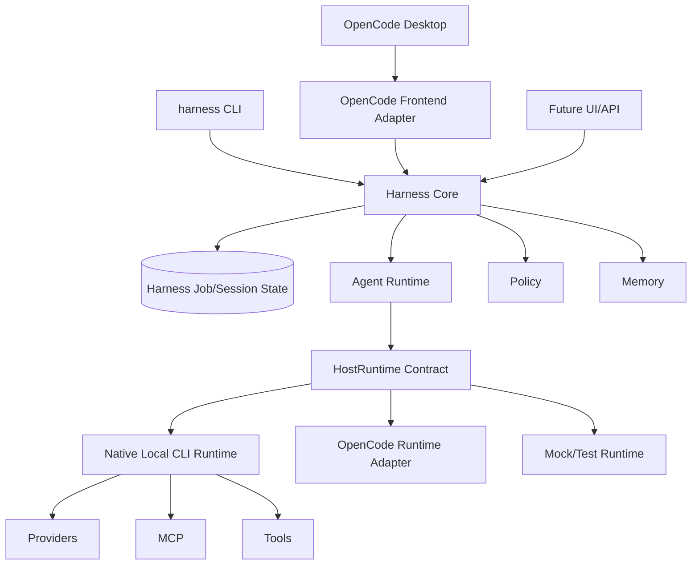

# Аудит замены OpenCode собственным CLI в Harness Portable

## Executive summary

**Вывод:** полная замена OpenCode технически возможна, но **прямой переход A → C сейчас инженерно невыгоден**. Для `harness-opencode-portable` оптимальна последовательность **A → B → C(optional)**:

**сначала стабилизировать текущий OpenCode-host → затем выделить строгий Host Runtime Adapter → только после этого подключить собственный CLI как второй backend и, если он достигнет функционального паритета, сделать его основным.**

Причина довольно сильная: архитектура репозитория уже почти подготовлена к отделению Harness от OpenCode. Сам native plugin прямо описан как *host adapter only* и не принимает решений о маршруте/роли/evidence; эти решения остаются в Core. Кроме того, через границу уже проходят нормализованные DTO, а не сырые OpenCode SDK-объекты. Однако эта абстракция пока недоведена: `HostContext.host` жёстко равен `"opencode"`, генератор агентов компилирует роли непосредственно в `.opencode/agent`, `host_integration_policy.json` знает только OpenCode, а часть MCP launchers напрямую запускает `opencode run`. citeturn22view1turn23view3turn25view0turn25view1turn25view2

Это важное различие: **замена OpenCode CLI не равна замене OpenCode runtime**. Сейчас OpenCode предоставляет проекту не только команду `run`, но и provider/auth layer, parent/child sessions, abort, session state, permissions, message API, filesystem/tool integration и headless server/OpenAPI. Собственный CLI при полном отказе от OpenCode должен либо реализовать эти возможности, либо сознательно сократить функциональность Harness. citeturn28view1turn18view0

Моя оценка:

| Критерий | A — OpenCode + исправления | B — Host Adapter | C — собственный CLI |
|---|---:|---:|---:|
| Изменение архитектуры | низкое | среднее | высокое |
| Зависимость Harness от OpenCode | высокая | локализованная | отсутствует в runtime |
| Риск обновлений OpenCode | высокий → средний | низкий | нулевой |
| Контроль session lifecycle | средний | высокий | полный |
| Автономность агентов | 6/10 | **8.5/10** | потенциально 9.5/10 |
| UX сейчас | высокий после фиксов | **лучший баланс** | сначала хуже |
| Переносимость | средняя | высокая | потенциально максимальная |
| Стоимость поддержки | средняя | средняя | высокая |
| Оценка работ* | **110–180 ч** | **260–420 ч** | **700–1100 ч MVP; 1400–2400 ч production parity** |
| Рекомендация | сделать обязательно | **целевая архитектура** | строить поверх B |

\*Это инженерная оценка с неопределённостью примерно ±35–40%, а не измеренное время. Диапазон C существенно выше, потому что OpenCode сегодня предоставляет целый host runtime: session tree, provider/auth APIs, prompts, abort, permissions, file/tool APIs и headless server. citeturn28view1

**Самое важное открытие аудита:** прежде чем обсуждать отказ от OpenCode, в текущей связке есть несколько P0/P1-дефектов, из-за которых часть наблюдаемой нестабильности может ошибочно восприниматься как фундаментальная проблема OpenCode.

В частности:

| Приоритет | Обнаружение | Последствие |
|---|---|---|
| **P0** | `deploy/bootstrap.sh:74–91` генерирует MCP-конфигурацию в формате `command: string + args`, без `type:"local"` | Не соответствует актуальному контракту OpenCode, где local MCP требует `type:"local"` и `command: Array`. citeturn23view0turn21view0 |
| **P0** | Там же используются `${PYTHON_BIN}` и `${OPENCODE_HARNESS_ROOT}` | Актуальная подстановка OpenCode имеет синтаксис `{env:NAME}`. citeturn23view0turn21view1 |
| **P0** | `bootstrap.sh:91` полностью перестраивает `cfg` | Стираются `model`, `small_model`, permissions и сторонние пользовательские настройки; committed config действительно содержит model settings, которые bootstrap уничтожит. citeturn23view0turn22view3 |
| **P0** | `semantic_execute.ts` возвращает объект, не соответствующий собственному `SemanticExecutionResult.schema.json` | Успешный ответ не содержит ряда обязательных полей; error path ещё сильнее расходится со schema. citeturn23view1turn24view0 |
| **P0** | Read-only семантика опирается на `tools: {}` | OpenCode уже зафиксировал переход от prompt-level tool map к permissions/agent policy и отдельную проблему с session-scoped restrictions в V2. Это очень хрупкая security boundary. citeturn23view1turn28view0turn28view2 |
| **P1** | `bootstrap` игнорирует ошибки pip, doctor и health | Пользователь получает `DONE` после частично сломанной установки. citeturn23view0 |
| **P1** | Bridge после смерти Python peer не перезапускается | Текущая OpenCode-сессия остаётся с мёртвым Harness bridge до reload/restart. citeturn23view2 |
| **P1** | `harness_run` всегда оборачивает транспортно успешный ответ в `{ok:true}`, даже если Core вернул `{ok:false}` | Два уровня `ok` создают ложноположительный success. citeturn24view1turn22view2 |
| **P1** | Версии SDK расходятся: plugin build `1.18.16`, project package `1.18.30`, README требует Desktop `1.18.30+` | Не существует единого зафиксированного compatibility baseline. citeturn24view2turn24view3turn22view0 |
| **P1** | `.opencode/opencode.json` в Git содержит абсолютные Windows-пути конкретной машины | Чистый clone до bootstrap не portable. citeturn22view3 |
| **P1** | Legacy launchers напрямую вызывают `opencode run` | Полная замена OpenCode сразу ломает этот слой. Сам проект уже считает его `opencode_cli_legacy`. citeturn25view2turn26view2 |

Поэтому **B — не компромисс, а правильная архитектурная точка разрыва зависимости**.

## Фактическая архитектура и точки отказа

Сейчас основной путь выглядит примерно так. README обещает project-scoped portable Harness с native plugin, Core, MCP и агентами; при этом v1 всё ещё описан как deterministic routing, а полноценный agent dispatch и live tribunal отнесены к дальнейшим фазам. citeturn22view0turn26view3



Здесь есть **два различных пути исполнения модели**: native reverse RPC через child OpenCode session и legacy launchers через отдельный `opencode run`. Репозиторий сам фиксирует legacy leakage и говорит, что этот путь должен оставаться fallback, а не production transport. citeturn26view2turn25view2

### Что конкретно ломается уже сейчас

**Bootstrap/config boundary.** Наиболее явный дефект находится не в Core, а в генераторе OpenCode config. `deploy/bootstrap.sh` генерирует:

```text
command: "${PYTHON_BIN}"
args: ["${OPENCODE_HARNESS_ROOT}/mcp/..."]
```

тогда как актуальная документация OpenCode определяет local MCP как объект с обязательным `type:"local"` и `command`-массивом. Для переменных документирован `{env:VARIABLE_NAME}`. Следовательно, текущий generated config следует привести к официальному schema contract независимо от выбранного A/B/C. citeturn23view0turn21view0turn21view1

Кроме того, строка `cfg = {"$schema": ..., "plugin": plugins, "mcp": mcp}` не merge-ит owned keys, а заменяет всю конфигурацию. Это особенно плохо потому, что committed `.opencode/opencode.json` имеет `model` и `small_model`, которые после bootstrap исчезнут. citeturn23view0turn22view3

Ещё одна переносимостная ошибка: bootstrap сначала корректно выбирает Python в `$PY`, но для генерации OpenCode config на строке 64 вызывает непосредственно `python3`. То есть пользовательский `PYTHON_BIN` не является полным источником истины. citeturn23view0

**Semantic contract boundary.** `SemanticExecutionResult.schema.json` требует `host_session_id`, `provider_id`, `model_id`, `structured_output`, `raw_output_ref`, `usage`, `timing`, `host_error`, `host_features_fingerprint`; TypeScript-interface делает значительную часть этих полей optional, а `semantic_execute.ts` при success вообще не выдаёт `raw_output_ref`, `usage`, `host_error`, `host_features_fingerprint`. При failure отсутствует даже `structured_output`. Это не косметика: валидатор, построенный по канонической JSON Schema, закономерно отвергнет результат самого host adapter. citeturn24view0turn23view3turn23view1

**Session lifecycle.** Child session создаётся правильно через `parentID`, но timeout реализован отдельным `setTimeout`; в показанном коде timer не очищается после успешного `Promise.race`, а abort вызывается fire-and-forget. Это создаёт нежелательное позднее `session.abort` уже после успешного завершения. Внешняя cancellation chain Harness → OpenCode тоже ещё не сертифицирована live; собственный technical-debt ledger проекта прямо помечает AbortSignal/cancel path как незавершённый. citeturn23view1turn26view2

Bridge дополнительно ограничивает reverse timeout максимумом `120000 ms`, хотя комментарий самого кода указывает canonical `timeout_ms` 180000 ms; без timeout значение вообще падает до 15000 ms. Это три разных time budget внутри одного execution contract. citeturn22view2

**Bridge lifecycle.** TS bridge содержит pending-map и timeout, но malformed messages просто отбрасываются, `exit` только reject-ит pending requests, автоматического respawn/re-handshake нет, а запись в stdin не имеет backpressure/error recovery. Поэтому crash Python peer превращается в постоянный `bridge closed` для существующего instance. citeturn23view2

При этом `bridge.hello` сообщает `core_api_supported: ["harness.status","harness.run"]`, хотя тот же peer регистрирует `semantic.execute` и `harness.cancel`. То есть capability negotiation не отражает реальный API. citeturn22view2

**Agent lifecycle.** Архитектура уже содержит `AgentRegistry` и compiler `agents/*.md → .opencode/agent/*.md`, что очень удобно для будущего host abstraction. Однако bootstrap запускает `compile_runtime.py`, но не `scripts/agent_gen/compile_agents.py`; roadmap при этом прямо требовал добавить генерацию агентов в bootstrap. Документация техдолга всё ещё содержит старое утверждение, что `.opencode/agent` отсутствует, хотя compiler уже существует. Это признак configuration/documentation drift. citeturn25view3turn25view0turn23view0turn26view0turn26view3

**Security boundary.** Native plugin сейчас в `tool.execute.before` жёстко блокирует только три имени. Сам technical-debt ledger признаёт, что прежний `session_guard` на untrusted tools был потерян и должен вернуться перед `webfetch`, search/doc extract. Одновременно OpenCode перенёс контроль tool access в `permission`, а не старый `tools` map. Это делает permission policy частью контракта host adapter, а не реализационной мелочью OpenCode. citeturn22view1turn26view1turn28view0

### Хорошая новость для замены

Сильнейшее место проекта — `runtime/registry.py`: роли, категории, model bindings и body prompt уже загружаются независимо от OpenCode SDK. OpenCode-specific часть появляется главным образом при компиляции этих записей в `.opencode/agent`. Значит, canonical `AgentSpec` можно сохранить, а OpenCode сделать просто одним renderer/backend. citeturn25view3turn25view0

Именно поэтому замена host реалистична без переписывания Writer/Researcher/Coder с нуля.

## Сравнение трёх вариантов

| Область | A — оставить OpenCode | B — абстракция HostRuntime | C — собственный CLI |
|---|---|---|---|
| Core routing | без изменений | без изменений | без изменений |
| Agent Registry | без изменений | становится canonical | становится canonical |
| OpenCode plugin | production | один из adapters | удаляется/optional |
| NDJSON bridge | остаётся | становится transport adapter | можно убрать внутри одного процесса |
| Child sessions | OpenCode | `SessionRuntime` interface | собственный store/runtime |
| Provider/auth | OpenCode | OpenCode или другой adapter | реализовать самим |
| MCP client | OpenCode + Harness MCP | facade | собственный MCP manager |
| Permissions | OpenCode + Harness guard | canonical Policy + host projection | canonical Policy |
| Legacy `opencode run` | остаётся fallback | запрещается вне adapter | заменяется |
| Config | OpenCode-centric | Harness config → backend projection | Harness-only |
| UX | Desktop-centric | единая `harness` команда + optional Desktop | CLI-centric |
| Update risk | OpenCode API | локализован адаптером | provider/MCP APIs |
| Масштабирование | зависит от OpenCode sessions | backend-neutral | полностью под контролем |
| Юридическая поверхность | Harness + OpenCode MIT | то же | Harness + provider SDKs/MCP deps |

OpenCode сегодня уже предоставляет programmatic server с OpenAPI, provider/auth endpoints, parent/child sessions, abort, prompts, permissions и file APIs. Поэтому B позволяет использовать эту зрелую host-функциональность, не позволяя её API растекаться по Harness Core. citeturn28view1

### Контракты, которые должны стать каноническими

Нынешние `host-context/1.0`, `workspace-ref/1.0`, `semantic-execution-request/1.0`, `semantic-execution-result/1.0` — хорошее начало; bridge уже объявляет их как protocol schemas. citeturn22view2turn23view3

Я бы эволюционировала их так:

| Контракт | Назначение |
|---|---|
| `host-context/2.0` | `host: string`, backend instance, capabilities, session lineage |
| `host-capabilities/1.0` | sessions, cancellation, tools, MCP, structured output, sandbox flags |
| `workspace-ref/1.1` | root, worktree, readonly, identity, allowed paths |
| `semantic-execution-request/1.1` | request + deadline + idempotency key + required capabilities |
| `semantic-execution-result/1.1` | единый terminal result без optional/required расхождения |
| `agent-dispatch-request/1.0` | agent, parent session, contract, context, permission profile |
| `agent-dispatch-result/1.0` | structured output + child session + artifacts |
| `host-error/1.0` | typed error, retriable, retry-after, cause |
| `host-health/1.0` | liveness/readiness/provider/MCP/capability status |

Главное правило: **семантика этих контрактов принадлежит Harness, а OpenCode/custom CLI только реализуют их.**

## Вариант A — сохранить OpenCode и исправить интеграцию

Это кратчайший путь к рабочей v1.1. OpenCode остаётся UI, session runtime, provider manager и tool host; Harness Core остаётся authority.



### Обязательные изменения

| Приоритет | Файл / функция | Правка |
|---|---|---|
| **P0** | `deploy/bootstrap.sh:64–95` | Генерировать официальную MCP schema: `type:"local"`, `command:[...]`, `{env:...}`; использовать `$PYTHON`, не `python3`. citeturn23view0turn21view0turn21view1 |
| **P0** | `deploy/bootstrap.sh:67–93` | Deep merge только Harness-owned plugin/MCP keys, не пересоздавать весь `cfg`. citeturn23view0 |
| **P0** | `semantic_execute.ts` | Единственный `makeSemanticResult()` и schema validation перед return. citeturn23view1turn24view0 |
| **P0** | `semantic_execute.ts:49–69` | `clearTimeout()` в `finally`, await abort, единый deadline. |
| **P0** | semantic security | Read-only child не должен зависеть от `tools:{}`; создать отдельного restricted agent/permission profile. V2 уже демонстрирует риск этого контракта. citeturn28view2turn28view0 |
| **P1** | `bridge_peer.py:_hello()` | Advertise semantic/cancel capabilities, protocol features и ranges. citeturn22view2 |
| **P1** | `bridge.ts` | child `error/exit` supervisor, bounded restart, handshake после respawn, backpressure. citeturn23view2 |
| **P1** | `harness_run.ts` | Не превращать Core `{ok:false}` в tool `{ok:true}`. citeturn24view1turn22view2 |
| **P1** | package versions | Одна tested/pinned OpenCode SDK baseline + `latest` compatibility job. Сейчас 1.18.16/1.18.30 расходятся. citeturn24view2turn24view3 |
| **P1** | bootstrap | Любой required install/compile/doctor failure завершает setup non-zero. Сейчас ряд ошибок подавляется. citeturn23view0 |
| **P1** | bootstrap | Вызывать `compile_agents.py`; затем `--check`. citeturn25view0turn26view3 |
| **P2** | `.opencode/opencode.json` | Не commit-ить machine-local absolute paths; хранить template/generated file. citeturn22view3 |

Пример корректного принципа генерации:

```json
{
  "mcp": {
    "academic_search": {
      "type": "local",
      "command": [
        "{env:PYTHON_BIN}",
        "{env:OPENCODE_HARNESS_ROOT}/mcp/academic_search_server.py"
      ],
      "enabled": true
    }
  }
}
```

Именно такую форму `type + command:Array` требует актуальный OpenCode MCP contract. citeturn21view0

### Что всё равно останется хрупким

Даже после исправлений semantic executor останется связан с OpenCode session SDK, plugin hooks и permission semantics. Уже в 2026 году OpenCode обсуждает изменение session-specific tool configuration между V1/V2; текущая реализация Harness использует как раз эту чувствительную область. citeturn23view1turn28view2

Поэтому A следует рассматривать как **stabilization release**, а не окончательную архитектуру.

### Оценка

Ориентир **110–180 человеко-часов**: config/bootstrap 20–30; semantic contract/lifecycle 25–40; bridge supervisor 20–30; security/permissions 20–30; compatibility/CI/E2E 25–50.

Миграция практически безболезненна: сначала чинится bootstrap → затем schema/lifecycle → bridge supervisor → permission boundary → live semantic certification → только потом включается `HARNESS_SEMANTIC_ENABLED=1`. Это соответствует собственной roadmap проекта, где live semantic execution сейчас является gated capability. citeturn22view1turn26view3

## Вариант B — HostRuntime adapter как целевая архитектура

**Это рекомендуемый вариант.**

OpenCode не выбрасывается; он перестаёт быть частью доменной архитектуры Harness.



### Главное изменение

Вместо:

```text
Core -> semantic_transport -> OpenCode plugin -> OpenCode session
```

становится:

```text
Core -> HostRuntime.semantic_execute(request)
                           |
             +-------------+-------------+
             |                           |
       OpenCodeAdapter              LocalCliAdapter
```

Это позволяет тестировать **весь Harness Core без OpenCode**.

### Предлагаемый API

```python
class HostRuntime(Protocol):
    def capabilities(self) -> HostCapabilities: ...
    async def health(self) -> HostHealth: ...

    async def create_session(
        self,
        parent_id: str | None,
        metadata: dict,
    ) -> SessionRef: ...

    async def execute(
        self,
        request: SemanticExecutionRequest,
    ) -> SemanticExecutionResult: ...

    async def cancel(self, execution_id: str) -> CancelResult: ...
    async def close_session(self, session_id: str) -> None: ...
```

Agent orchestration следует сделать отдельным уровнем:

```python
class AgentRuntime(Protocol):
    async def dispatch(
        self,
        request: AgentDispatchRequest,
    ) -> AgentDispatchResult: ...
```

Именно `harness.dispatch` уже предусмотрен roadmap проекта как роль + input contract → child session → validation → structured output. citeturn26view1turn26view3

### Какие места придётся изменить

| Сейчас | После B |
|---|---|
| `packages/.../src/host/types.ts` жёстко содержит `host:"opencode"` | `HostContext/2.0` принимает backend ID; OpenCode normalization остаётся в adapter. citeturn23view3 |
| `config/host_integration_policy.json` знает `native_plugin` и `opencode_cli_legacy` | `backends: {opencode, local_cli, mock}` + selected/default backend. citeturn25view1 |
| `scripts/agent_gen/compile_agents.py` пишет только `.opencode/agent` | `AgentSpec` canonical + `OpenCodeAgentCompiler`; позже `CliAgentCompiler`. citeturn25view0 |
| `mcp/launchers/_runner.py` вызывает `OPENCODE_BIN` | вызывает `HostRuntime.execute()`; direct OpenCode backend спрятан внутри adapter. citeturn25view2 |
| semantic transport знает plugin RPC | знает только HostRuntime |
| doctor проверяет OpenCode | doctor проверяет выбранный backend capabilities |
| models представлены host-specific ID | `ModelRef(provider, model, capabilities)` |

Особенно важно убрать прямое использование `OPENCODE_BIN` из `_runner.py`: это крупнейшая утечка host abstraction. Сам технический долг проекта уже квалифицирует эту группу launchers как legacy CLI transport. citeturn26view2

### Структура кода

Целевая форма может быть такой:

```text
contracts/
  host-context.schema.json
  host-capabilities.schema.json
  semantic-request.schema.json
  semantic-result.schema.json
  agent-dispatch.schema.json
  host-error.schema.json

runtime/
  host/
    base.py
    registry.py
    lifecycle.py
    errors.py
    opencode.py
    local_cli.py
    mock.py

runtime/
  agents/
    spec.py
    dispatch.py
    contracts.py

packages/
  opencode-harness-plugin/
    ...             # только adapter OpenCode

cli/
  harness.py

config/
  host_backends.json
```

При этом существующий `runtime/registry.py` логично превратить в source of truth для `AgentSpec`, потому что он уже собирает роли, permissions, categories и model bindings независимо от OpenCode SDK. citeturn25view3

### Почему B повышает автономность

Сейчас отказ OpenCode plugin/bridge фактически означает потерю semantic execution. После B Core сможет сделать:

```text
OpenCode backend unhealthy
        ↓
circuit breaker
        ↓
Local CLI backend available?
        ↓ yes
resume same Harness execution_id
```

То есть **автономность появляется не от собственного CLI самого по себе, а от того, что agent state принадлежит Harness, а execution backend становится заменяемым.**

Это принципиально важнее.

### Оценка

**260–420 человеко-часов**, включая A.

Примерное распределение: canonical contracts 30–50; HostRuntime/lifecycle 40–70; OpenCodeAdapter migration 40–60; launcher migration 30–50; agent compiler split 20–30; CLI façade/doctor 20–35; conformance/fault-injection/CI 50–80; migration/documentation 30–45.

Риск B значительно ниже C, потому что сложные provider/auth/session возможности пока остаются реализованы OpenCode; официальный host уже предоставляет session create/children/abort, provider/auth и message endpoints. citeturn28view1

## Вариант C — полностью собственный CLI и runtime

Этот вариант становится рациональным **после B**, когда можно заменить только реализацию `HostRuntime`.



Здесь исчезают TS plugin, OpenCode-specific bridge и обратный `semantic.execute` hop. Это делает архитектуру намного чище, но переносит на Harness обязанности host runtime.

### Что собственный CLI обязан реализовать

**Минимально полноценный runtime**, а не только argument parser:

| Модуль | Функция |
|---|---|
| `CLI` | `init`, `doctor`, `run`, `resume`, `cancel`, `agents`, `models`, `config` |
| `ConfigResolver` | defaults → project → env → CLI override |
| `SecretStore` | API keys/tokens без попадания в prompts/logs |
| `SessionStore` | parent/child graph, lifecycle, resume |
| `JobJournal` | durable execution state и idempotency |
| `AgentOrchestrator` | route → agent → contract → execution |
| `ModelGateway` | provider adapters, stream, usage, timeout |
| `ToolRuntime` | read/write/bash/search etc. |
| `PermissionEngine` | deny/ask/allow/capability policy |
| `WorkspaceGuard` | root/path/symlink/process boundaries |
| `MCPManager` | spawn/connect/restart/health MCP |
| `CancellationManager` | hierarchical cancellation |
| `EventBus` | structured event stream |
| `Doctor` | readiness/capabilities/providers/MCP |
| `Observability` | logs, traces, metrics, correlation IDs |

Иными словами, OpenCode сегодня уже представляет собой сервер с OpenAPI, sessions, children, abort, providers/auth, messages, file APIs и permissions. Если C должен сохранить текущие возможности agent system, эти функции придётся заменить собственными эквивалентами. citeturn28view1turn28view0

### Сессии и замкнутый цикл

Я бы не копировала модель OpenCode один-в-один. Для Harness естественнее:

```text
Job
 ├── Attempt
 │    ├── AgentExecution
 │    │    ├── ModelCall
 │    │    ├── ToolCall
 │    │    └── Artifact
 │    └── Child AgentExecution
 └── terminal state
```

Каждый объект получает:

```text
execution_id
parent_execution_id
idempotency_key
state
attempt
deadline
backend
agent
model
created_at
heartbeat_at
finished_at
result_ref
error_code
```

Состояния должны быть конечным автоматом:



Это решает слабое место нынешней схемы, где OpenCode session и Harness Job являются разными сущностями и их корреляция пока в значительной мере metadata-based; собственный tech-debt ledger отдельно фиксирует это различие. citeturn26view2

### Что сломается при выключении OpenCode

**Немедленно:**

`packages/opencode-harness-plugin/**` теряет runtime-смысл; `.opencode/**` больше не является host config; `scripts/agent_gen/compile_agents.py` теряет OpenCode target; `config/host_integration_policy.json` становится устаревшим; `mcp/launchers/_runner.py` и перечисленные launchers больше не смогут вызвать `opencode run`; model identifiers могут потребовать нормализации; Desktop UX и child OpenCode sessions исчезают. citeturn25view0turn25view1turn25view2

При этом текущие `agents/*.md`, `runtime/registry.py`, routing/config contracts, Writer/Researcher/Coder logic, jobs и большая часть Harness Core потенциально сохраняются, потому что они не требуют OpenCode SDK напрямую. citeturn25view3turn22view1

### Производительность

C потенциально быстрее архитектурно: исчезает цепь TypeScript plugin → child Python NDJSON → reverse RPC → TypeScript → OpenCode session для semantic call. В текущем bridge каждый RPC поддерживает отдельный pending state, а Python reverse side использует собственный timeout/cancellation mechanism. citeturn23view2turn22view2

Но производительность LLM-heavy системы обычно определяется не локальным IPC, а network/model latency. Поэтому **главное преимущество C — не миллисекунды, а контроль concurrency, persistence и recovery**.

Для production CLI нужны bounded worker pools и backpressure. Нынешний bridge не является достаточным шаблоном масштабирования: он не содержит supervisor/restart/backpressure слоя на TS side. citeturn23view2

### Оценка

**700–1100 ч** — headless MVP, если оставить ограниченный набор providers/tools.

**1400–2400 ч** — уровень, при котором C действительно может заменить OpenCode для обычного пользователя: authentication, multiple providers, robust tool loop, MCP lifecycle, permissions, resumable sessions, recovery, installer/update, diagnostics и multi-platform CI.

Поэтому C стоит начинать не с удаления OpenCode, а с:

```text
HostRuntime
    ├── OpenCodeBackend
    └── HarnessCliBackend  ← новый
```

и несколько релизов гонять оба backend одной conformance-suite.

## Надёжность, безопасность и предотвращение отказов

### Failure model

Для всех трёх вариантов нужен единый typed error contract:

```json
{
  "schema": "host-error/1.0",
  "code": "PROVIDER_RATE_LIMIT",
  "message": "...",
  "retriable": true,
  "retry_after_ms": 3000,
  "execution_id": "...",
  "backend": "opencode",
  "cause": null
}
```

Нельзя принимать решение о retry через поиск `"timed out"` в тексте ошибки, как это сейчас делает `semantic_execute.ts`. citeturn23view1

| Ошибка | Retry |
|---|---|
| temporary network / 429 / 5xx | да |
| bridge crash | после restart + idempotency lookup |
| MCP process crash | один restart/circuit breaker |
| timeout | только если operation declared retry-safe |
| auth | нет |
| permission denied | нет |
| schema violation | нет |
| invalid request | нет |
| model context overflow | только после explicit compaction strategy |

Backoff: exponential + full jitter, например base `500 ms`, cap `30 s`, ограничение attempts и общий deadline. **Retry всегда должен подчиняться deadline задачи**, а не иметь собственный независимый timeout.

### Idempotency и транзакционность

Критическое правило:

```text
retry transport != repeat semantic action
```

`execution_id` должен стать idempotency key. Перед model/tool execution:

```text
BEGIN
  if execution_id terminal:
      return persisted result

  acquire execution lease
  append EXECUTION_STARTED
COMMIT
```

После выполнения:

```text
BEGIN
  persist result/artifacts
  mark terminal
  release lease
COMMIT
```

Лучший pragmatic store для standalone CLI — SQLite/WAL плюс content-addressed artifacts. Это даёт atomic state transitions, resume и простой portable deployment без отдельной СУБД.

### Recovery

После crash CLI:

```text
scan RUNNING
   ↓
heartbeat expired?
   ↓
mark INTERRUPTED
   ↓
operation idempotent?
   ├─ yes → retry attempt N+1
   └─ no  → NEEDS_RECONCILIATION
```

Для tool calls с side effects необходим отдельный `operation_id`; нельзя автоматически повторять `git push`, публикацию, удаление файла или внешний POST только потому, что потерялся transport response.

### Cancellation

Cancellation должна быть иерархической:

```text
Job.cancel()
   ↓
AgentExecution.cancel()
   ↓
ModelCall.cancel()
   ↓
child agents
   ↓
MCP/subprocesses
```

Сейчас bridge уже имеет `harness.cancel`, но live AbortSignal propagation остаётся незакрытой частью roadmap. citeturn22view2turn26view2

### Contract versioning

Не связывать protocol version с package version:

```text
Harness Core          1.4.0
OpenCode adapter      0.4.0
Host RPC              2.1
Semantic contract     1.1
Agent contract        1.0
```

Handshake:

```json
{
  "protocol": ["harness-host-rpc/2.0", "harness-host-rpc/2.1"],
  "capabilities": {
    "parent_sessions": true,
    "cancel": true,
    "structured_output": true,
    "session_permissions": false,
    "mcp": true
  }
}
```

Это лучше нынешнего подхода, где fallback host version захардкожен как `1.18.16`, проектная dependency уже `1.18.30`, а `_hello()` при этом не сообщает весь реально реализованный API. citeturn22view1turn24view2turn24view3turn22view2

### Security model

Для A OpenCode permission system можно использовать как host enforcement layer; OpenCode поддерживает `allow/ask/deny`, granular bash/edit/path rules и отдельные agent permissions. citeturn28view0

Но Harness должен иметь **собственную policy authority**, иначе вариант B/C невозможен:

```text
Harness Policy
    ↓ compile
+---------------------+
| OpenCode permission |
| Own CLI capabilities|
| MCP allowlist       |
+---------------------+
```

Предлагаемый default:

```text
read workspace         allow
edit workspace         ask/role-specific
bash                   deny-by-default
network                deny-by-default
external_directory     deny
secrets                never exposed
spawn subagent         role-specific
MCP                     explicit allowlist
```

Особенно важно вернуть native guard на untrusted content: проект сам фиксирует, что текущий plugin blocking только трёх internal tools слабее прежнего `session_guard`. citeturn22view1turn26view1

Для C дополнительно нужны canonical path validation, symlink escape checks, subprocess env allowlist, no-shell execution где возможно, resource limits и раздельные capability tokens для tool calls.

Сама `_runner.py` прямо предупреждает, что её isolated run directory **не является OS sandbox** и безопасность filesystem сейчас предполагает ограничения host/runtime policy. При отказе от OpenCode эта обязанность полностью перейдёт Harness. citeturn25view2

### Health и observability

Нужны три разных состояния:

```text
liveness   = процесс жив
readiness  = можно принять новую задачу
capability = конкретная функция реально доступна
```

Например:

```json
{
  "live": true,
  "ready": false,
  "backend": "opencode",
  "checks": {
    "core": "ok",
    "session_api": "ok",
    "provider": "auth_required",
    "mcp:academic": "ok",
    "mcp:searxng": "degraded"
  }
}
```

Это гораздо полезнее нынешнего `_health()`, который фактически проверяет присутствие `config/`, и `_status()`, который в основном проверяет файлы snapshot. citeturn22view2

Для каждого execution логировать:

```text
trace_id
job_id
attempt_id
execution_id
parent_execution_id
host_session_id
agent
route
backend
provider/model
tool
duration
retry_count
result_status
```

Секреты, полный prompt и полный tool payload по умолчанию в telemetry не пишутся.

## Тестирование, CI/CD, UX, лицензирование и план миграции

### Conformance вместо backend-specific тестов

Ключ к безопасной замене OpenCode:

```text
HostRuntimeConformanceSuite
          |
     +----+----+
     |         |
 OpenCode   OwnCLI
 Adapter    Adapter
```

Оба backend обязаны проходить одинаковые тесты:

| Test family | Обязательные случаи |
|---|---|
| contracts | valid/invalid schema, unknown version |
| session | root/child/create/close/resume |
| lifecycle | success/fail/timeout/cancel |
| idempotency | duplicate execution ID |
| recovery | backend dies mid-call |
| security | denied tool/path/network |
| MCP | spawn/crash/reconnect/timeout |
| provider | auth/429/5xx/context overflow |
| agent | dispatch/child/structured contract |
| concurrency | 1/10/100 calls + cancellation |
| portability | clean clone on Windows/Linux/macOS |

Сам проект уже указывает на необходимость live cancellation и теста 100 concurrent messages, поэтому concurrency/failure tests должны стать release gate, а не только unit suite. citeturn26view2

Минимальный CI-каркас:

```yaml
name: ci

on:
  pull_request:
  push:

jobs:
  contracts:
    strategy:
      matrix:
        os: [ubuntu-latest, windows-latest, macos-latest]
    runs-on: ${{ matrix.os }}
    steps:
      - uses: actions/checkout@v4
      - uses: actions/setup-python@v5
        with:
          python-version: "3.11"
      - run: python runtime/registry.py --validate
      - run: python scripts/agent_gen/compile_agents.py --check
      - run: pytest -q

  opencode-adapter:
    runs-on: ubuntu-latest
    steps:
      - uses: actions/checkout@v4
      - uses: actions/setup-node@v4
        with:
          node-version: "lts/*"
      - run: npm ci
        working-directory: packages/opencode-harness-plugin
      - run: npm run typecheck
        working-directory: packages/opencode-harness-plugin
      - run: npm test
        working-directory: packages/opencode-harness-plugin

  host-conformance:
    runs-on: ubuntu-latest
    strategy:
      matrix:
        backend: [mock, opencode]
    steps:
      - uses: actions/checkout@v4
      - run: pytest tests/host_conformance -q
        env:
          HARNESS_HOST_BACKEND: ${{ matrix.backend }}
```

Для B после появления собственного backend matrix просто становится:

```yaml
backend: [mock, opencode, local_cli]
```

Отдельный scheduled compatibility job должен проверять **зафиксированную production-версию OpenCode и актуальную latest**, потому что OpenCode contract уже развивается вокруг permissions/session APIs. citeturn28view2turn18view0

### UX пользователя

Самый удобный конечный UX при B/C:

```text
harness init
harness doctor
harness run "задача"
harness resume <job>
harness status
harness config
```

`harness init` должен быть единственным installer/configurator и сам выбирать backend:

```text
Detected OpenCode: yes
OpenCode adapter: compatible
Python: ok
Models: 2 available
MCP: 3/4 ready
Harness: READY
```

То есть пользователь больше не должен понимать `OPENCODE_HARNESS_ROOT`, file URI plugin, bridge protocol, venv или вручную выяснять, загрузился ли native plugin.

В B OpenCode Desktop становится **опциональным frontend** к Harness. В C пользователь получает полностью замкнутый product experience.

### Влияние на автономность и UX

| Вариант | Автономность | UX |
|---|---|---|
| A | Host crash/OpenCode incompatibility останавливает semantic layer | знакомый Desktop; установка остаётся двухстековой Python+Node+OpenCode |
| B | Harness владеет execution state и способен переключать backend | **лучший вариант:** одна команда Harness, Desktop optional |
| C | полный контроль над execution/recovery | простейший mature UX, но пока runtime не достигнет зрелости — больше ошибок и меньше возможностей |

Таким образом, **для “замкнутости” системы B уже даёт большую часть преимуществ C**, если durable Job state, contracts и retry/recovery принадлежат Harness.

### Лицензирование

OpenCode распространяется под MIT, поэтому сама по себе его замена не требуется ради избавления от copyleft-ограничений. Репозиторий OpenCode также просит проекты, использующие `opencode` в собственном имени, явно указывать отсутствие аффилиации с командой OpenCode. citeturn21view4

В анализируемом репозитории корневой `LICENSE` не виден в root tree, а прямой запрос `LICENSE` возвращает 404, при том что `packages/opencode-harness-plugin/package.json` декларирует `"license": "MIT"`. Это означает, что **лицензионный статус всего repository следует формализовать отдельно от package metadata** перед распространением продукта. citeturn22view0turn20view0turn24view2

Для production release я бы добавила:

```text
LICENSE
THIRD_PARTY_NOTICES.md
SBOM.spdx.json
DEPENDENCY_LICENSES.json
SECURITY.md
```

При C юридическая поверхность OpenCode исчезнет, но появится прямая ответственность за лицензии provider SDK, OAuth implementations, MCP dependencies и распространяемые binaries.

### Рекомендуемая миграция

**Первый этап — P0 stabilization, вариант A.**

Исправить `bootstrap` schema/merge/env; перестать подавлять required failures; исправить `SemanticExecutionResult`; сделать timeout/cancel lifecycle детерминированным; включить schema validation; вернуть deny-by-default security boundary; унифицировать OpenCode dependency baseline. Эти дефекты подтверждаются текущим кодом и официальными OpenCode contracts. citeturn23view0turn24view0turn21view0turn21view1turn28view0

**Второй этап — выделить Harness-owned contracts.**

`HostContext/2.0`, `HostCapabilities`, `HostError`, `AgentDispatch`, единый `SemanticResult`. Убрать `"opencode"` из canonical types. Существующие DTO и bridge schemas дают хорошую стартовую базу. citeturn23view3turn22view2

**Третий этап — HostRuntime.**

Ввести `OpenCodeHostRuntime`; заставить Writer/Coder/Researcher/Tribunal обращаться только через него. Никаких `OPENCODE_BIN`, SDK calls или `.opencode` вне adapter/compiler layer. Legacy `_runner.py` в его текущей форме должен исчезнуть из production execution path. citeturn25view2turn26view2

**Четвёртый этап — ownership состояния.**

Перенести Job/Attempt/AgentExecution state в Harness journal; OpenCode session ID становится внешней ссылкой backend, а не идентичностью Harness task.

**Пятый этап — собственный CLI как façade.**

Даже продолжая пользоваться OpenCode backend:

```text
harness run
    ↓
Harness Core
    ↓
OpenCodeHostRuntime
```

Пользователь уже перестаёт зависеть от деталей OpenCode установки.

**Шестой этап — LocalCliHostRuntime.**

Реализовать session store → model gateway → permission engine → MCP → tools. Сначала read-only semantic agents, затем Researcher, затем Tribunal, затем coding/write agents с side effects.

**Седьмой этап — dual-run certification.**

Одни и те же фиксированные задачи прогонять через:

```text
OpenCodeHostRuntime
LocalCliHostRuntime
```

и сравнивать runtime status, structured contract, artifacts, permission decisions, cancellation и recovery.

**Восьмой этап — переключение default.**

Только когда custom backend проходит HostRuntime conformance, fault injection и security suite:

```text
default_backend = "local_cli"
fallback_backend = "opencode"
```

И уже следующим релизом OpenCode dependency можно сделать optional.

### Итоговая целевая форма

Архитектурно оптимальный результат для проекта выглядит не как **«Harness вместо OpenCode»**, а как:



В этой схеме **Harness владеет задачей, состоянием, контрактами, политикой, памятью, retry/recovery и agent lifecycle**. OpenCode, собственный CLI или будущий remote executor становятся заменяемыми средствами исполнения.

Это устраняет главный архитектурный риск нынешней системы: сегодня Core формально считается authority, но жизненный цикл semantic execution, security restrictions и часть agent/runtime поведения фактически всё ещё зависят от конкретного OpenCode SDK/CLI contract. Сам проект уже движется в сторону child sessions, `harness.dispatch`, memory, role contracts и native guard; HostRuntime abstraction логично завершает это направление, не выбрасывая уже работающую инфраструктуру. citeturn22view1turn26view1turn26view3

**Практическая рекомендация:** не выбирать между B и C. **Сделать B архитектурным фундаментом, а C — его backend.** Тогда стоимость перехода перестаёт быть ставкой «всё или ничего»: OpenCode можно сохранять сколько угодно долго как совместимый frontend/runtime, а собственный CLI постепенно довести до точки, где его переключение в default станет изменением конфигурации, а не очередной миграцией всей агентной системы.