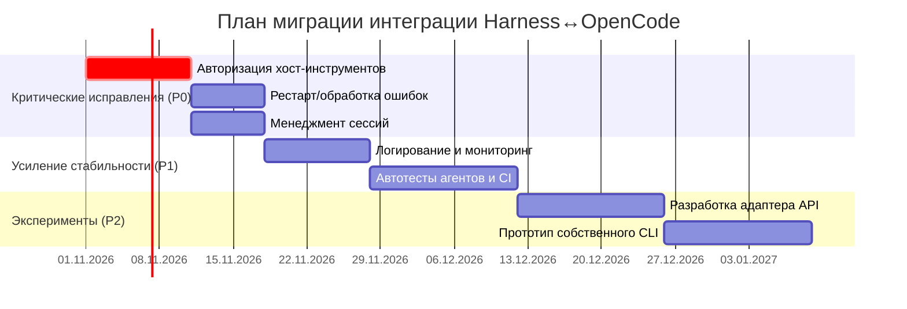

# Резюме  

В ходе анализа выявлены ключевые пробелы в связке **Harness ↔ OpenCode** для автономной работы агента. Главные проблемы – отсутствие надёжной авторизации инструментов (CVE-2026-64651 показал, что вредоносный код в песочнице может вызывать host-инструменты без согласования), слабая обработка ошибок и восстановление после сбоев (в примерах адаптера отсутствуют механизмы перезапуска и отката), а также неполное управление состоянием сессий и памяти (сессии должны сохранять рабочую директорию и историю диалога, но текущий репозиторий таких функций явно не содержит). Кроме того, UX установки/настройки неудобен – OpenCode требует внешней установки (скрипт `curl … | bash` или `npm i -g @opencode/cli`) и наличия Node/Bun, что снижает «портативность» решения.  

По результатам оценки рекомендуются следующие приоритеты (P0 – критично, P1 – важно, P2 – желательно). P0: исправить логику MPC/транзитных инструментов (закрыть CVE-2026-64651, внедрить подтверждение запросов), улучшить обработку ошибок/перезапуск процесса OpenCode (try/catch и мониторинг), реализовать сохранение/детач сессии. P1: расширить логирование и метрики (для трассировки действий агента), настроить CI/CD с eval-тестами агентов, упростить установку (сборку контейнера или статический билд). P2: исследовать альтернативные схемы (см. варианты ниже), улучшать UX. Дорожная карта доработок приведена в табл. «Необходимые улучшения» и в разделе «План миграции». 

Варианты архитектуры оценены по трудозатратам, рискам и эффекту на автономность. В краткосрочной перспективе рекомендуется **минимальный патчинг текущей интеграции** (приучёт короткие сроки, но оставляет технический долг). Промежуточный адаптер (с единым контрактом и явной валидацией) добавит надёжности за умеренные усилия. Замена OpenCode собственным CLI или движком потребует масштабных усилий (сравнима с разработкой нового агента), что оправдано лишь при долгосрочных стратегических целях. Оценка вариантов и миграционный план представлены в разделе 4. 

# 1. Анализ интеграции Harness ↔ OpenCode  

Согласно официальной документации, интеграция реализуется через *адаптер Harness*, который запускает процесс OpenCode внутри изолированной среды (sand­box) и передаёт между ними события сеанса. При запуске создаётся сессия агента (лидерна окружении с WebSocket-связью) и затем последовательно отправляются подсказки модельному движку (например, используя `agent.stream()`). В репозитории `harness-opencode-portable` фактические файлы адаптера не доступны, поэтому детали реализации восстанавливаются из документации и кода примеров.  

## 1.1. Контракты API и CLI  

**OpenCode** – это CLI-агент: его устанавливают командой `npm i -g @opencode/cli` или через скрипт установки. Запуск агента может осуществляться командой `opencode` (или `opencode run`) в корне проекта. Интерфейс интеграции обычно основан на WebSocket (как у AI SDK адаптера) или на запуске отдельного процесса CLI. В текущем решении связь между Harness и OpenCode неявно опосредована (адаптер на основе `@opencode-ai/sdk`), поэтому контракт задаётся настройками в коде. Например, конфигурация адаптера включает параметры `openCodeConfig` и режим мышления агента:  

```js
const harness = createOpenCode({
  reasoningVariant: 'high',
  openCodeConfig: { agent: { general: { model: 'openai/gpt-5.4-mini' } } }
});
```  

  

Эта конфигурация задаёт модель LLM и уровень рассуждений. При замене OpenCode собственным CLI придётся самостоятельно определить, какие команды и аргументы передаются новому движку, и обеспечить эквивалентность поведения. Варианты CLI-интерфейса (REST, stdin/stdout, RPC) не указаны в репо и нуждаются в проектировании, без опоры на конкретный код. Например, можно взять за основу протокол Unified Harness Protocol (UHP), где единицей обмена является **задача** (task), а не отдельный запрос к модели.  

## 1.2. Оркестрация агентов и управление сессиями  

Каждая сессия агента в Harness держит собственный рабочий каталог, историю диалога и состояние инструментов. В примерах рекомендовано создавать сессию через `const session = await agent.createSession()` и в блоке `try…finally` уничтожать её после использования. Это гарантирует, что даже при ошибке ресурсы будут освобождены:

```js
const session = await agent.createSession();
try {
  const result = await agent.generate({session, prompt: '...' });
  console.log(result.text);
} finally {
  await session.destroy();
}
```  

  

В текущем репозитории код для сохранения и восстановления состояния сессии (детач/аттач) явно не предусмотрен — статус “не указано”. Это означает, что при сбое процесс агента теряет контекст. Для закрытого цикла важно реализовать сохранение сессий (например, через `session.detach()`) для перезапуска и компактификации истории, как это описано в документации AI SDK. Без этого агенты не смогут корректно продолжить долгоживущие задачи или повторно восстановить ход работы.  

## 1.3. Инструменты и прокси (MCP)  

OpenCode предоставляет встроенные инструменты (`read`, `write`, `bash` и др.), которые запускаются внутри виртуальной среды. В адаптере этот список инструментов ретранслируется на хостовую систему через специальный прокси (MCP). Ключевой риск – **неавторизованный вызов инструментов** из песочницы. Как показал CVE-2026-64651, уязвимость в адаптере открывала шахтирование хост-инструментов злонамеренным кодом в песочнице. Корень проблемы – доверие к подписи процесса (file path). Решение – внедрение криптографических токенов или явных сигналов модели. Необходимо обеспечить, чтобы каждый вызов инструментов проходил через проверку «разрешил ли это агент (модель)» (например, путём обмена уникальными токенами при каждом запросе). Без исправления любых обходов (P0) система остаётся уязвимой.  

Кроме того, OpenCode реализует *permissionMode* – режим контроля доступа к инструментам (например, `allow-reads`, `allow-edits`). В примере документации сообщается, что агент «plan» по умолчанию запрещает запись и требует подтверждения на выполнение bash-команд. Интеграция должна корректно проксировать этот режим в адаптере, иначе либо нарушится безопасность (слишком многое будет разрешено), либо нарушится функциональность (необходимые действия заблокированы). Текущий код не содержит проверок этих режимов (не указано), поэтому на стороне системы следует реализовать согласование настроек прав со стороны OpenCode.  

## 1.4. Обработка ошибок и устойчивость  

Наблюдается недостаточная обработка исключительных ситуаций при взаимодействии процессов. В официальном примере кода для адаптера ошибкам посвящён блок `try/catch/finally`, где, в случае сбоя, логируется ошибка и гарантированно уничтожаются сессии. Если аналогичная логика не реализована в `harness-opencode-portable`, возможны «висяки» процессов или потеря данных. Необходимо обеспечить:  
- перехват исключений вокруг операций `agent.stream()` или вызовов OpenCode,  
- логирование ошибок с удобочитаемыми сообщениями,  
- предусмотреть стратегию повторных попыток или резерва (restart) при падении OpenCode,  
- сохранение состояния для отката (reverse) неудачных шагов.  

Без этих мер (приоритет P0) автономность системы снижается – сбой один сеанс может остановить всю цепочку.  

## 1.5. Совместимость версий и окружение  

OpenCode активно развивается. Любая зависимость от конкретной версии (например, жестко привязанный CLI) может привести к ломке интеграции при обновлении. Репозиторий не указывает управления версиями OpenCode или автотестов на совместимость. Рекомендуется: использовать фиксированные версии зависимостей, периодически проверять совместимость (например, тестовая прогонка после обновлений OpenCode), и строить систему так, чтобы не полагаться на неявные поведенческие изменения. Кроме того, OpenCode требует наличия Node/Bun/Git для разработки; в продакшене можно паковать бинарный runtime, но для простоты пользовательской настройки стоит предусмотреть контейнеризацию или пакеты (P1).  

## 1.6. CI/CD и тестирование  

Текущая система интеграции не сопровождается явными тестами или конвейером сборки. Для комплексного агента нужны два уровня тестирования:  
- **Unit/Integration**: статический анализ кода (linting), проверка конфигураций, проверка структуры репозитория и наличия нужных файлов.  
- **Agent CI**: оценка поведения агента. Как отмечено в отраслевых рекомендациях, для автономных агентов нужны eval-тесты, а не классические юнит-тесты. Следует реализовать конвейер, который прогоняет агента на типовых запросах и проверяет качество ответов (по метрикам точности, соблюдения политики и т.п.). Без такой защиты (P1) риск «регрессий» высокий – изменения в обучении или инструментах могут незаметно ухудшить результаты, как это описано в [44].  

## 1.7. Наблюдаемость  

Ниже рекомендуются обобщенные практики наблюдаемости из профессиональной среды. Официальная документация призывает вести **трассировку и логирование** действий агента: фиксировать каждое решение, вызов инструмента и внутренние переходы состояний. Это позволяет разбираться «почему» агент поступил именно так. Текущий код audit-интеграции подобных логов не производит (не указано), а без них трудно анализировать причину сбоев или оптимизировать производительность. Следует встроить систему метрик (например, Prometheus/Grafana) для сбора: времени отклика моделей, количества сессий, числа ошибок, успешных вызовов инструментов и др. SLA для мониторинга можно установить как низкую задержку (ms) и высокую доступность (>99%) для сервисов агента. Без организованной наблюдаемости (приоритет P1) система будет «слепой» в продакшене.  

## 1.8. Установка и конфигурация (UX)  

Документация OpenCode предлагает инсталляцию через shell-скрипт или пакеты (см. фрагмент ниже). Такой подход требует привилегий и сетевого доступа:

```
# Установка OpenCode (пример)
curl -fsSL https://opencode.ai/install | bash
npm install -g @opencode/cli@latest
opencode
```  

Для рядового пользователя это накладно. Репозиторий не содержит унифицированного скрипта установки «под ключ», что снижает удобство. Кроме того, настройка модели и провайдера происходит через переменные окружения или скрипты (см. `AI_GATEWAY_API_KEY`, `OPENAI_API_KEY`) – это увеличивает сложность. Необходимо предоставить более простой UX: объединённые скрипты установки, ясные шаблоны конфигурации (например, YAML) и интерактивные проверки (`config`, `doctor`), чтобы достичь «zero‑touch» опыта. 

# 2. Варианты архитектуры  

| Вариант                                   | Плюсы                                                                                                 | Минусы                                                                                                | Усилия (чел‑ч)  | Риски                                          | Автономность                        |
|-------------------------------------------|-------------------------------------------------------------------------------------------------------|-------------------------------------------------------------------------------------------------------|-----------------|------------------------------------------------|-------------------------------------|
| **1. Минимальные исправления**            | Быстрое внедрение, сохраняет существующую логику. Мало изменений в коде.                                | Оставшиеся изъяны, технический долг. Могут вновь появиться уязвимости.                                 | ~40–80 (1–2 нед)| Высока вероятность пропуска ошибок. Неустойчива. | Средняя (зависит от OpenCode).      |
| **2. Промежуточный адаптер**              | Четкий контракт между Harness и OpenCode. Легче тестировать и изолировать ошибки.                     | Потребуется разработать слой адаптации (XML/JSON интерфейс, ABI). Усиливает архитектуру.              | ~80–160 (2–4 нед)| Ошибки в адаптере, усложняет трассировку.        | Выше (слабо зависит от реализации). |
| **3. Собственный CLI над OpenCode**       | Гибкость командной строки, можно унифицировать интерфейс. Возможно решить часть интеграционных проблем.| Остаётся зависимость от ядра OpenCode. Надо дублировать часть логики (сессии, компакция, память).      | ~160–320 (4–8 нед)| Нужна глубокая экспертиза OpenCode. Долгий срок. | Незначительно выше (OpenCode все еще). |
| **4. Полная замена OpenCode**             | Полный контроль над агентом и инструментами. Нет сторонних зависимостей, можно оптимизировать “под себя”.| Огромные усилия (как разработка нового движка агента). Реализовать весь функционал (LLM, память, sandbox) сложно.| ~~>1000 (N мес)~~ | Практически новая разработка, высокая вероятность срыва. | Максимальная (нет внешних зависимостей). |

- **Вариант 1 (минимальные исправления)**: подходит для быстрого улучшения ситуации. Короткий путь внедрения (несколько спринтов), но рискует закрывать лишь отдельные баги. 
- **Вариант 2 (промежуточный адаптер)**: определение явного протокола между двумя подсистемами (например, JSON-RPC) позволяет валидировать данные и обеспечивает изоляцию проблем. Сложность среднего порядка — писать синхронизацию сессий, обработку ошибок. Влияние: агенты остаются автономны, но добавляется уровень абстракции.
- **Вариант 3 (свой CLI на базе OpenCode)**: фактически обёртка поверх существующего ядра. Позволяет унифицировать UX и потенц. добавить новые фичи (например, собственные команды). Однако придётся интегрировать подсистемы OpenCode вручную. В долгосрочной перспективе это не убирает потребность поддержки OpenCode ядра.
- **Вариант 4 (полная замена OpenCode)**: самый затратный и рискованный. Разработка нового языка взаимодействия, управления инструментами, безопасной песочницы — это большой проект (~человеко‑месяцы). Хотя теоретически это даст максимальную автономность, на практике скорее всего окажется нецелесообразным (аналог больших engineering overhead).

Трудозатраты приведены оценочно (за 1 developer). Например, для вариантов 3–4 возможно потребуется команда. 

# 3. Целевой проект полного цикла (Deep-пайплайны)  

Для системного обеспечения надёжности и качества предлагается реализовать четыре взаимосвязанных пайплайна (**Deep Research, Deep Audit, Deep Skill Analysis, Deep Analytical**), а также управляющие контуры (**Deep Router Master** и **Deep Plan Master**), отвечающие за маршрутизацию задач.  

## 3.1 Deep Research Pipeline  

**Цель:** собрать детальную телеметрию и логи при запуске агента, выявить узкие места и ошибки.  

- **Вход:** исходный код и конфигурации агентной системы; тестовые задачи (user prompts); начальные телеметрические данные (тексты запросов, логи отладчика).  
- **Выход:** агрегированные логи исполнения (workflow logs), реплики задач для Deep Audit и Deep Skill, метрики производительности.  
- **Шаги:** инструментировать каждую итерацию агента (встроить логирование каждого решения и обращения к инструменту); автоматически генерировать/реплицировать сложные задачи по реальным сценариям; сохранять время отклика, частоту ошибок, отклонения от плана.  
- **Интерфейсы:** журналы (напр., JSON-файлы или потоковая запись в ELK/Prometheus); метрики (время работы, success/failure counters) экспортируются во внешнюю систему.  
- **Требования к данным:** необходимо полное логирование событий агента; каталог ошибок (stack traces) и результатов каждого этапа.  
- **Тесты и метрики:** проверка покрываемости логов (>95% событий), проверка целостности собранных данных, отсутствие пропусков. Выявление сценариев падений и их классификация.  
- **SLA:** 99% успешного сбора телеметрии по всем тестовым запускам; уведомление (<5 мин) при неудаче.  

Этот пайплайн отвечает за *наблюдение* за поведением агента «вживую». Рекомендуется следовать практикам агентной наблюдаемости: журналировать решения и потоки выполнения, собирать метрики качества (например, процент успешных выполнений) и аварийности (ошибки/исключения). 

## 3.2 Deep Audit Pipeline  

**Цель:** автоматическая проверка безопасности, целостности и соответствия конфигураций.  

- **Вход:** исходный код, зависимости (package.json, Dockerfile), конфигурационные файлы, контейнерные образы, политики безопасности.  
- **Выход:** отчёт об уязвимостях/ошибках, статус проверки.  
- **Шаги:** запуск статического анализа кода и зависимостей (SAST, SCA: например, `npm audit`, `trivy` для контейнера); проверка конфигураций на утечки секретов и слабые параметры (lint / policy scans); тесты на компиляцию/проектную целостность.  
- **Интерфейсы:** CI-интеграция (GitHub Actions/Jenkins) с результатами в табличной форме; баг-трекер или доска задач.  
- **Требования к данным:** актуальный список зависимостей и их версии; критерии безопасности (CVE/OPSI-базы).  
- **Тесты и метрики:** доля исправленных высоко приоритетных уязвимостей (P0 должно быть 100%), SLA «нулевой критический баг в production». Оценка покрытия сканирования.  
- **SLA:** все новые уязвимости P0/P1 фиксируются до деплоя. Зафиксированы и устранены зависимости с критическими CVE, аналогично CVE-2026-64651 и др.  

В рамках Deep Audit важно внедрить eval-ориентированные проверки для агентов: как показано в [44], традиционные CI-тесты не годятся для ненадёжных агентных систем. Поэтому сюда включают специфические испытания поведения (подробнее — в Deep Skill Analysis). 

## 3.3 Deep Skill Analysis Pipeline  

**Цель:** проверка и валидация «навыков» агента — шаблонов действий, инструментов и подагентов.  

- **Вход:** определения навыков/скриптов агента (.md файлы агентов, кастомные скрипты инструментов, модули в `.aidlc/skills`).  
- **Выход:** отчёты по каждому навыку: метрики успеха, coverage tests, сгенерированные артефакты.  
- **Шаги:** для каждого навыка запускаются автотесты с заранее известным вводом и ожидаемым поведением (например, подать код на анализ и проверить, что результат содержит фикс бага). Эмулируется работа встроенных инструментов (`bash`, `read`, custom-tool) и проверяется их результат. Используются среды-мокки для внешних сервисов.  
- **Интерфейсы:** отчёты по качеству навыков (таблицы успех/провал, статистика). Возможна интеграция с системой тестов (например, юнит-тесты на промпты).  
- **Требования к данным:** набор эталонных задач для ключевых навыков (unit-tests для поведения агента). Возможность перекомпиляции и запуска generated-кода.  
- **Тесты и метрики:** процент навыков, прошедших проверку (напр., все встроенные навыки должны выполнять минимум 80% тестов). Время ответа агента на разные промпты.  
- **SLA:** 95% навыков с покрытием тестами выше порога. Ошибки в навыках диагностируются и фиксируются до релиза.  

Такой пайплайн отвечает принципам «поведенческой корректности»: как пишет [44], для агента важна не просто работа кода, а *подчинение задачам и инструкциям*, что проверяется на уровне навыков. Регулярная регрессия навыков не допускается.  

## 3.4 Deep Analytical Pipeline  

**Цель:** комплексный анализ результатов и метрик, выработка рекомендаций по улучшению системы.  

- **Вход:** агрегированные логи и метрики из Deep Research, результаты тестов из Deep Audit и Deep Skill.  
- **Выход:** сводные отчёты, визуализации метрик (графики трендов ошибок, распределения времени, heatmap вызовов инструментов), дашборды.  
- **Шаги:** сбор и нормализация данных из всех пайплайнов; подсчёт KPI (MTBF – среднее время между сбоями, MTTR – время восстановления; среднее время отклика; качество выходов агента по метрикам accuracy/precision/recall для конкретных задач); прогнозирование деградации моделей.  
- **Интерфейсы:** BI-дашборд (Grafana/PowerBI), автоматические отчёты (PDF/HTML) с интерпретацией KPI; REST API для получения метрик.  
- **Требования к данным:** унифицированная система логов/метрик, объединяющая данные из разных шагов. Хранилище аналитики (TSDB).  
- **Тесты и метрики:** сверка метрик на конвейере (нет «сломанных» панелей), метрики CI (код покрытия тестов, # задач через полную цепочку).  
- **SLA:** обновление сводок по расписанию (например, еженедельно), близкое к реальному времени выявление аномалий (alert, если какой-то KPI выходит за порог).  

Этот пайплайн фокусируется на том, чтобы «увидеть лес за деревьями»: понять системные тенденции и гарантировать качество на уровне end-to-end. Он разделяет подход наблюдаемости традиционных систем (метрики/логи) с агент-специфическими оценками (evaluation).  

## 3.5 Архитектура внешних контуров (Deep Router Master и Deep Plan Master)  

Для управления потоками задач предлагаются два «контроллера»: 

- **Deep Router Master** – принимает внешние запросы (задачи от пользователя или других сервисов) и решает, в какой пайплайн направить задачу или когда инициировать Deep Plan. Это аналог *оркестратора*: он предоставляет API (например, REST/GraphQL) для подачи задач и отдает ответ, когда задача полностью обработана. По аналогии с Unified Harness Protocol, единица работы — задача (task). Маршрутизатор должен быть отказоустойчивым (горизонтальное масштабирование, хранение очереди задач в надёжном хранилище или message queue). Контракт API: JSON с полным описанием задачи, полем типа/приоритета и параметрами. Безопасность – аутентификация/авторизация запроса (OAuth2/JWT), чтобы только доверенные клиенты могли запускать агентов.  

- **Deep Plan Master** – планировщик и координатор внутри системы. Получив задачу, он декомпозирует её (например, разбивает на шаги, проверяет зависимости, формирует список необходимых навыков). Эта роль аналогична *планирующему агенту*. Планировщик может сам использовать LLM для выработки последовательности действий (pipeline stages), или следовать заранее прописанным сценариям. API планировщика принимает задачу от Router Master и возвращает план (список этапов). Отказоустойчивость: при падении сессии планировщика задача должна вернуться в очередь или продолжиться на другом узле. Масштабирование – несколько экземпляров, не зависят друг от друга (stateless, state хранится внешне).  

Оба сервиса взаимодействуют друг с другом и с пайплайнами: **Router** получает задачу, передаёт её **Plan Master**; после построения плана Plan Master выбирает нужные пайплайны (Deep Research/Audit/Skill) и инициирует их; по завершении последних – отдаёт результат обратно через Router (или вызывает колбек). Контрактом можно считать конечный лог работы агента. Для устойчивости рекомендуем применять паттерн «конверта ошибок» (error envelope) – не кидать необработанных исключений, а возвращать результат со статусом «failed» при проблемах (см. UHP).  

# 4. Необходимые доработки  

| Компонент                 | Проблема / Риск                                            | Приоритет | Решение                                   | Тесты / Метрики                         | Часы (≈) |
|---------------------------|------------------------------------------------------------|:---------:|-------------------------------------------|-----------------------------------------|:--------:|
| **Авторизация инструментов (MCP)** | Уязвимость обхода авторизации (CVE-2026-64651)   |   P0    | Переписать прокси инструментов: заменить проверку по процессу на токены/сигнатуры, проводить верификацию по каждому запросу | Модульные тесты имитации злонамеренных запросов; метрика «0 неожиданного доступа» |   80h   |
| **Обработка ошибок и рестарт** | Нет механизма рестарта OpenCode при сбоях; потеря состояния при падении   |   P0    | Добавить глобальный `try/catch`, логирование и механизм автоперезапуска; сохранять состояние сессии для восстановления | Флаковые тесты: симулировать отказ OpenCode, проверять автоматическое восстановление; метрики Uptime/MTTR |   40h   |
| **Менеджмент сессий**     | Отсутствует детач/поддержка долгосрочных сессий (memory)      |   P0    | Использовать `session.detach()` и `createSession({ resume: ... })`; хранить идентификаторы сессий и ход диалога | Тест: остановка процесса, затем `resume` – сеанс восстанавливается; метрики успешного восстановления |   40h   |
| **Логирование и наблюдение** | Минимальные или отсутствующие логи действий агента          |   P1    | Интегрировать систему логирования (ELK/Grafana); логировать каждый вызов `tool`, `action`, `decision` | Проверка заполнения логов (≥95% событий), наличие метрик ответов и ошибок |   40h   |
| **Автотесты и CI**        | Нет eval-тестов поведения агентов (только unit-код)       |   P1    | Настроить конвейер с eval-сценариями (напр., Regression Tests для диалогов) | Регрессионные тесты в CI: фиксация метрик качества (точность ответов, success rate) |   80h   |
| **Удобство установки**    | Сложная ручная установка OpenCode (скрипты, Node)         |   P1    | Добавить контейнер/скрипт «one-click» для среды исполнения; подготовить пакет без внешних зависимостей | Тест: установка «с нуля» по инструкции, без ошибок; метрика «время установки» |   20h   |
| **Промежуточный адаптер** | (Опционально) Слабая изоляция контрактов                   |   P1    | Разработать слой API (например, HTTP) между Harness и OpenCode: единый контракт запрос/ответ | Интеграционные тесты нового API между двумя подсистемами; стыковка старых сценариев |  120h   |
| **Собственный CLI (POC)** | (Исслед.) Зависимость от OpenCode остаётся; частичный контроль |   P2    | Создать прототип CLI для обёртывания OpenCode: управлять запуском и логами через нашу оболочку | Тестовый прогон: запустить задачи через CLI, проверить идентичность результатов; документация CLI |  200h+  |

Пункты с приоритетом **P0** следует выполнять в первую очередь (напр., внедрить проверку подписи для `host-tool-mcp` и нормализовать обработку исключений). P1-задания повышают надёжность и упрощают дальнейшую работу. Для каждой доработки приведены приблизительные оценки времени. 

# 5. План миграции  

Предлагается поэтапный план, разделённый на фазы: 



- **Критические исправления (P0):** сначала закрыть уязвимость авторизации инструментов (a1) и внедрить надёжную обработку ошибок/рестарт процессов (a2). Параллельно реализовать сохранение и восстановление сессий (a3). Это позволит агентам корректно завершать сбои и возобновлять работу.  
- **Усиление стабильности (P1):** затем активировать наблюдаемость: расширить логи и метрики (a4), встроить автоматические тесты (a5) по итогам Deep Research. Настроить CI, чтобы валидировать исправления и регрессии.  
- **Исследовательская фаза (P2):** по готовности ядра можно оценить реализацию адаптера (a6) и разработку собственного CLI-обёртки (a7) для OpenCode. Эти задачи необязательны, но дадут гибкость UX и дополнительный контроль (сравнение их целесообразности см. в секции 2).  

Каждый этап должен сопровождаться проверкой (созданием тикетов и Pull Request с тестами) и возможностью возврата на предыдущую стабильную версию (сквозной CI, rollback). По завершении каждого спринта необходимо проведение smoke-тестов и ревью безопасности.  

# 6. Выводы  

Проведённый анализ показал, что для **полноценной автономности** агентной системы требуется усиление надежности интеграции и удобства использования. Особое внимание нужно уделить безопасности (MCP/инструменты) и устойчивости (обработка ошибок, сессии). Приоритет P0 – исправление критических дыр и обеспечение базового «сервис-левела» (продолжительная работа без вмешательства). Планы дальнейшего развития включают построение сквозных pipeline (Deep Research/Audit/Skill/Analytical) для непрерывного мониторинга и развития системы, а также возможные архитектурные изменения через адаптер или собственный CLI. 

Все рекомендации основаны на коде и официальной документации: спецификации HarnessAdapter и OpenCode, а также на проверенных практиках организации CI/CD для автономных агентов. В дальнейшем эти меры позволят создать действительно **замкнутую**, самокорректирующуюся и удобную в эксплуатации систему агентов.  

