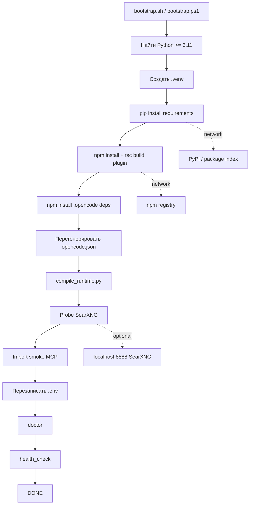
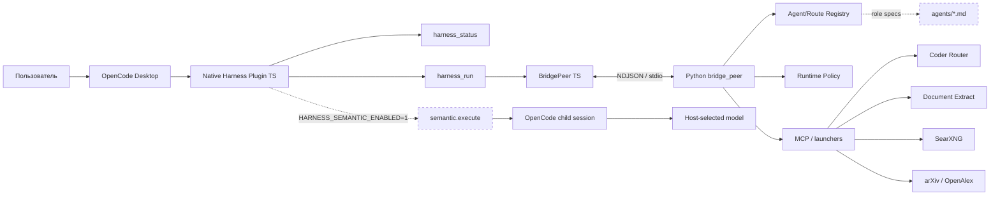
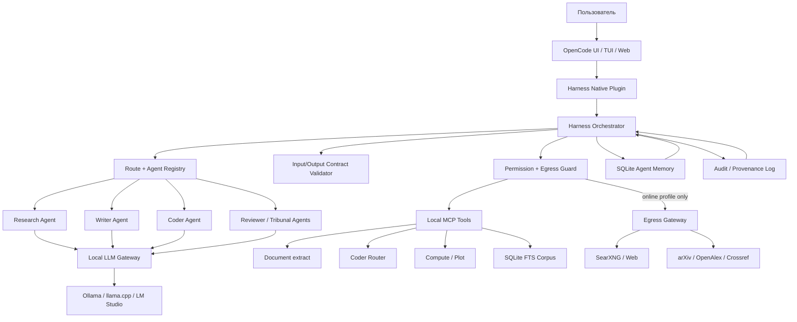
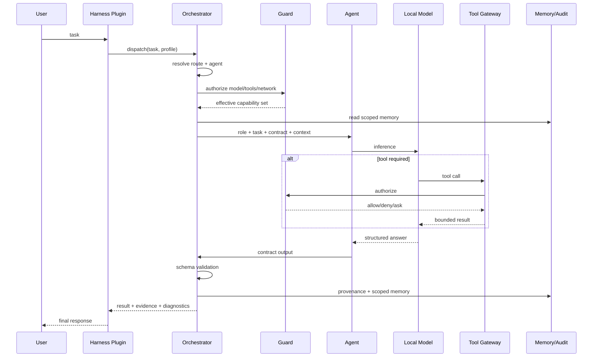
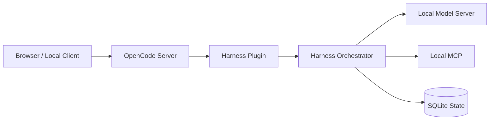
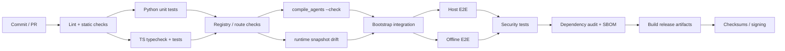

# Глубокий аудит `harness-opencode-portable`: готовность к полноценной агентной системе, offline/self-hosted и конечному пользователю

## Executive summary

Аудит выполнен по текущему состоянию ветки `master`, доступному на **14 октября 2026 года**, с приоритетом на исходники репозитория, конфигурации, bootstrap-скрипты, runtime/plugin-код, MCP-серверы, внутренний technical-debt tracker и актуальную официальную документацию OpenCode. Статус ниже — результат статического аудита; фактический end-to-end запуск на машине с OpenCode Desktop в рамках этого анализа не выполнялся.

**Главный вывод:** репозиторий уже значительно больше, чем набор промптов или демонстрационный прототип: в нём есть реестр агентов, детерминированный роутинг, Python runtime, TypeScript-плагин OpenCode, двунаправленный bridge, несколько MCP-серверов, guard-код, code/research/writer-пайплайны, большое количество тестовых артефактов и bootstrap для Windows/Linux/macOS. README позиционирует проект как self-contained portable Harness с 15 ролями и 132 skills. При этом сам README и internal tech-debt прямо фиксируют, что полноценная агентная интеграция, память, динамический контекст, role contracts, native guard и live tribunal ещё не завершены. citeturn0view0turn10view0turn11view0

Поэтому в текущем виде я бы классифицировал проект не как «готовую автономную агентную систему», а как **сильный framework/runtime foundation с частично подключённым host adapter**. Ключевой разрыв проходит между хорошо развитой внутренней инфраструктурой и тем, что реально доступно конечному пользователю через OpenCode. Например, `harness_run` выполняет детерминированное разрешение маршрута и прямо описан в исходнике как инструмент, **не исполняющий semantic model**; основной plugin экспортирует всего `harness_status` и `harness_run`, а semantic execution включается только при `HARNESS_SEMANTIC_ENABLED=1`. citeturn12view0turn12view1

### Итоговая оценка

| Область | Оценка | Почему |
|---|---:|---|
| Внутренняя архитектурная база | **7.5/10** | Есть manifests, registries, routes, bridge, MCP, provider/capability registry, tests, writer/research/code subsystems. citeturn1view1turn3view0turn3view3 |
| Реальная агентность через host | **4/10** | Роли и генератор есть, но dispatch/live subagents и production semantic path остаются незамкнутыми; `harness_run` не запускает модель. citeturn11view0turn12view1 |
| Offline/air-gapped готовность | **3/10** | Default model — `polza/...`; academic MCP ходит в arXiv/OpenAlex; bootstrap устанавливает pip/npm зависимости из сети; offline bundle отсутствует. citeturn17view0turn20view1turn22view0 |
| Self-hosted с локальным LLM | **6/10 потенциально** | Архитектура позволяет заменить модель локальным OpenAI-compatible backend; OpenCode официально документирует Ollama, llama.cpp и LM Studio. Но repo не предоставляет готовый local profile. citeturn9view0turn9view1 |
| Безопасность/приватность | **4/10** | Есть guard-инфраструктура, но native enforcement частичный; `.env` фактически не git-ignored; отсутствует project-wide permission baseline; один MCP намеренно обходит proxy. citeturn17view1turn12view0turn22view0 |
| Установка/UX | **5/10** | Есть bootstrap, doctor и README quickstart, но bootstrap способен разрушительно перезаписать OpenCode config и `.env`, продолжает работу после ряда ошибок и может показать `DONE` после неуспешного doctor/health. citeturn21view0turn21view1turn21view3 |
| Воспроизводимость/release engineering | **4/10** | Python-зависимости заданы диапазонами без hashes; bootstrap использует `npm install`; полноценного offline artifact bundle не обнаружено. citeturn7view0turn7view1turn20view1 |

Есть несколько особенно важных находок.

**Во-первых, агентный слой не доведён до замкнутого цикла.** В репозитории уже появился `scripts/agent_gen/compile_agents.py`, который генерирует OpenCode definitions, но bootstrap его не запускает. Более того, генератор жёстко пишет в `.opencode/agent/`, тогда как актуальная документация OpenCode на дату аудита документирует project agents в `.opencode/agents/`. Это может быть следствием ориентации проекта на более старый OpenCode 1.18.x; поэтому я квалифицирую это как **обязательную проблему совместимости, которую надо проверить на поддерживаемой матрице**, а не как безусловное доказательство поломки именно 1.18.30. citeturn23view0turn23view1turn9view4

**Во-вторых, bootstrap сейчас является одним из главных источников риска.** Он сохраняет существующий массив `plugin`, но затем создаёт новый top-level config только из `$schema`, `plugin` и `mcp`, то есть способен удалить существующие `model`, `provider`, `permission`, agent settings и другие пользовательские настройки. Он регистрирует только три MCP-сервера, хотя одновременно проверяет импорт `doc_extract`; committed `.opencode/opencode.json`, напротив, содержит `doc_extract`. На Linux/macOS генерация дополнительно запускается через literal `python3`, а не через ранее найденный `$PYTHON`. citeturn21view0turn21view1turn19view0

**В-третьих, committed `.opencode/opencode.json` сам по себе не portable.** В нём зафиксированы абсолютные Windows-пути на дисках `E:` конкретного разработчика и удалённая модель `polza/deepseek/deepseek-v4-flash-0731`. После корректного bootstrap это должно было бы исправляться, но состояние репозитория «из коробки» противоречит слову portable. citeturn19view0

**В-четвёртых, имеется прямое security-противоречие:** README/bootstrap утверждают, что `.env` git-ignored, но текущий `.gitignore` состоит только из `__pycache__/` и `*.pyc`. Это означает, что пользователь, следуя документации и добавив в `.env` API key или иной secret, не получает обещанной защиты от случайного коммита. citeturn17view1turn21view1

**В-пятых, полного offline bootstrap сейчас нет.** `pip install`, обновление pip и `npm install` являются штатной частью installation path; academic MCP отправляет запросы непосредственно в `export.arxiv.org` и `api.openalex.org`; provider registry также содержит внешние health probes OpenAlex, arXiv и Crossref. citeturn20view1turn22view0turn16view0

Приоритет разработки я рекомендую выстроить так:

**Сначала** исправить bootstrap/config/secrets и заставить agent compilation + host dispatch работать end-to-end. **Затем** добавить обязательный local/offline model profile и deny-by-default egress/security policy. **После этого** вводить memory, contracts, tribunal и полнофункциональный guard. И только потом имеет смысл инвестировать в отдельный GUI и polished installers.

При работе одного инженера, хорошо знакомого с Python/TypeScript/OpenCode, моя оценка для **закрытого single-user MVP** — примерно **4–6 инженерных недель**, а для существенно более production-ready варианта с offline bundle, CI matrix, security hardening, memory, live tribunal и надёжным upgrade path — порядка **8–12 недель**. Это инженерная оценка, а не факт из репозитория; она предполагает отсутствие фундаментальных несовместимостей с выбранной фиксированной версией OpenCode.

## Технический аудит текущего состояния

### Структура репозитория

Manifest репозитория декларирует более тысячи файлов и показывает довольно широкую декомпозицию: `agents`, `config`, `deploy`, `docs`, `guard`, `mcp`, `packages/opencode-harness-plugin`, `runtime`, `scripts`, `skills`, `templates`, `tests`, `.opencode`. citeturn1view1turn3view0turn3view1turn3view2

| Область | Что уже есть | Оценка |
|---|---|---|
| `agents/` | Source-specs ролей, включая writer/research/code/reviewer/fact-checking роли | Хорошая основа реестра, но источник роли ≠ гарантированно работающий OpenCode agent. citeturn11view0turn23view1 |
| `runtime/` | Registry, model bindings и runtime policy | Архитектурно полезно; model bindings фактически пусты для отдельных агентов. citeturn17view0 |
| `config/` | Routes, tools, MCP, memory, research/provider policies, skill graphs, tribunal | Один из наиболее развитых участков проекта. citeturn3view0turn3view1 |
| `packages/opencode-harness-plugin/` | Native TypeScript plugin, bridge, tools, doctor | Это фактический host adapter к OpenCode. citeturn3view3turn4view0turn12view0 |
| `mcp/` | Academic search, SearXNG, document extract, coder router и launchers | Хорошее разделение инструментов, но online/offline capabilities смешаны. citeturn3view3turn22view0 |
| `guard/` | Guard runner, semantic/session layers, threat-model и docs | Присутствует зрелая концептуальная база; native enforcement пока не покрывает весь фактический tool surface. citeturn3view2turn11view0 |
| `scripts/` | Router compiler, agent generator, jobs, research, writer, code factory, capsules | Сильная внутренняя capability layer. citeturn4view1turn5view0turn5view1 |
| `skills/` | Большой skill corpus; README заявляет 132 skills | Содержательно полезно, но число здесь следует трактовать как заявление README. citeturn0view0 |
| `deploy/` | PowerShell + shell bootstrap | Golden-path существует, но сейчас недостаточно безопасен. citeturn19view2turn19view3 |
| `tests/` | Много router/bridge/semantic/code tests | Локальная test base уже существенная. citeturn5view2turn5view3 |

По структуре это скорее **modular agent runtime/harness**, чем обычный OpenCode plugin. Это плюс: модель, роутинг, tools и host adapter разделены достаточно явно, что облегчает переход к полностью локальному backend. citeturn3view0turn12view0

### Фактическая runtime-архитектура

Native plugin определяет root проекта и Python binary, запускает Python bridge peer как дочерний процесс и общается с ним по NDJSON/JSON-RPC-подобному stdio protocol. В обратную сторону Python peer может запросить `semantic.execute`, который TypeScript-слой реализует через создание child session OpenCode. citeturn12view0turn13view1turn13view2

Однако пользовательский execution surface значительно уже внутренней архитектуры:

```text
OpenCode-visible:
    harness_status
    harness_run

Internal / optional:
    bridge
    semantic.execute
    registries
    routes
    MCP
    guard
    writer/research/code pipelines
```

`harness_run` принимает задачу/маршрут/profile, разрешает routing bundle и возвращает готовность, но его source-level description прямо подчёркивает, что semantic model он не запускает. citeturn12view1

Semantic execution существует отдельно, причём включается plugin-ом только при `HARNESS_SEMANTIC_ENABLED=1`. Это хороший механизм для controlled rollout, но плохой default для продукта, который позиционируется конечному пользователю как агентная система: штатный UX не завершает цепочку `task → route → agent → model → tools → validated result`. citeturn12view0turn12view3

### Агенты

Внутренний roadmap/tech debt фиксирует незавершённые задачи вокруг native subagents, role→model mapping, dynamic prompts, memory, agent-to-agent contracts, dispatch и live tribunal. citeturn10view0turn10view1turn11view0turn11view2

При этом кодовая база уже продвинулась дальше некоторых текстов документации: `compile_agents.py` существует, читает `agents/*.md`, `runtime/model_bindings.json` и route authorities, проверяет неизвестные agent references и генерирует agent definitions вместе с registry index. Это означает, что в репозитории присутствует **documentation/state drift**: генератор уже написан, но полноценная host registration всё ещё не является частью bootstrap golden path. citeturn23view0turn23view1

Есть ещё два существенных момента.

Первый: output директория generator-а жёстко задана как `.opencode/agent`. Текущая официальная документация OpenCode использует `.opencode/agents/`. Для поддержки legacy 1.18.x можно сохранить compatibility adapter, но новая версия должна определять host version и генерировать в документированный для неё location. citeturn23view0turn9view4

Второй: `runtime/model_bindings.json` задаёт default model `polza/deepseek/deepseek-v4-flash-0731`, но `agents` пуст. То есть заявленная model-per-role архитектура пока не материализована в явную operational configuration. citeturn17view0

### Конфигурация OpenCode

Committed config:

```json
{
  "$schema": "https://opencode.ai/config.json",
  "model": "polza/deepseek/deepseek-v4-flash-0731",
  "small_model": "polza/deepseek/deepseek-v4-flash-0731",
  "plugin": [
    "file:///E:/Documents/.../packages/opencode-harness-plugin/dist/index.js"
  ]
}
```

содержит machine-specific absolute Windows paths и таким образом сам по себе не portable. Аналогичные абсолютные пути присутствуют в командах всех четырёх MCP-серверов. citeturn19view0

Bootstrap пытается исправить это генерацией config, но создаёт другую проблему: существующий config не merge-ится, а практически заменяется:

```python
cfg = {
    "$schema": "https://opencode.ai/config.json",
    "plugin": plugins,
    "mcp": mcp,
}
```

Следовательно, bootstrap способен удалить пользовательские `model`, `small_model`, `provider`, `permission`, agent config и любые будущие OpenCode settings, которые он не знает. PowerShell-версия делает по сути то же самое. citeturn21view0turn21view2

Это нужно считать **критическим UX/configuration defect**, потому что повторный «идемпотентный» запуск может менять unrelated user state.

Дополнительно bootstrap генерирует MCP в виде:

```json
{
  "command": "${PYTHON_BIN}",
  "args": [".../server.py"],
  "cwd": ".../mcp"
}
```

а committed config использует:

```json
{
  "type": "local",
  "command": ["python", "server.py"],
  "enabled": true
}
```

Актуальная официальная документация OpenCode на 14 октября 2026 года документирует именно второй концептуальный вариант: `type: "local"` и массив `command`. Поэтому fresh bootstrap сегодня порождает config, не соответствующий текущей документированной схеме. Возможна историческая совместимость с OpenCode 1.18.x, но она в репозитории не зафиксирована тестовой матрицей. citeturn21view0turn19view0turn9view2

Есть и прямой consistency bug: bootstrap регистрирует `academic_search`, `coder_router`, `searxng_search`, но **не `doc_extract`**, хотя несколькими строками ниже проверяет зависимости и import самого `doc_extract_server`. Committed config `doc_extract` содержит. citeturn21view1turn19view0

### Зависимости и требования окружения

README указывает Python 3.11+, Node/npm для сборки при отсутствии prebuilt plugin dist и OpenCode Desktop 1.18.30+ как протестированную базу. citeturn0view0

Python dependency set содержит, среди прочего, PyYAML, requests, sympy, matplotlib, numpy, MCP SDK, python-docx, markdownify, pypdfium2, openpyxl, PyMuPDF, tifffile и Pillow. Версии преимущественно заданы через нижние границы (`>=`) либо широкий `mcp>=1,<2`, без lock/hashes. citeturn7view0turn7view1turn7view2

Plugin package использует TypeScript и зависимости `@opencode-ai/plugin` / `@opencode-ai/sdk` версии 1.18.16, тогда как README говорит о Desktop 1.18.30+. Это не обязательно несовместимость, но означает, что репозиторию необходима явная compatibility matrix вместо неявного предположения «>= 1.18.30». citeturn7view3turn0view0

Не указаны:

| Требование | Состояние |
|---|---|
| Минимальная RAM | **не указано** |
| CPU requirements | **не указано** |
| GPU/VRAM для локальных моделей | **не указано** |
| Требуемое место на диске для offline bundle/models | **не указано** |
| Поддерживаемые версии Node | **не указано** |
| Максимальная подтверждённая версия OpenCode | **не указано** |
| Поддерживаемые Python micro/minor версии выше 3.11 | **не указано** |
| Требования Docker для штатного режима | SearXNG предлагается через пример Docker-команды, но Docker не обозначен как обязательная системная зависимость. citeturn21view1 |
| GPU backend / CUDA / Metal strategy | **не указано** |
| Air-gap installation procedure | **не указано** |

### Build/install/start scripts

Фактический shell flow выглядит примерно так:



Эта последовательность следует непосредственно из bootstrap scripts. citeturn21view0turn21view1turn21view2

У shell-версии обнаруживаются несколько надёжностных проблем:

`pip install` может завершиться ошибкой, после чего bootstrap лишь выводит warning и всё равно печатает `requirements installed`; `npm install` подавляется через `|| true`; `compile_runtime` лишь warning; doctor и health запускаются с `|| true`; после этого выводится `DONE` и «Portable Harness module ready». citeturn21view0turn21view1

PowerShell также продолжает после ряда non-zero dependency/install/probe случаев и в конечном итоге не превращает doctor/health в обязательный readiness gate. citeturn21view2turn21view3

Это создаёт опасный **false-green installation state**.

На Linux/macOS есть ещё один дефект: bootstrap сначала тщательно выбирает Python в `$PY`/`$PYTHON`, но config generation запускает literal `python3`. Если пользователь указал `PYTHON_BIN`, а `python3` отсутствует в PATH, установка может сломаться именно на этой стадии. citeturn21view0

### MCP и внешние интеграции

Academic MCP явно использует два удалённых endpoint:

```python
ARXIV_BASE = "https://export.arxiv.org/api/query"
OPENALEX_BASE = "https://api.openalex.org/works"
```

и отправляет им пользовательский query. API keys для этих двух методов код не требует. citeturn22view0

Особенно важная деталь для enterprise/privacy режима: сервер намеренно создаёт `ProxyHandler({})`, то есть отключает использование proxy settings urllib из environment, поскольку комментарий говорит о конфликте с VNNet proxy. Таким образом, application-level корпоративный proxy policy может быть обойдён этим конкретным client path; сетевой firewall, разумеется, по-прежнему остаётся внешним ограничителем. citeturn22view0

`providers_authority.json` дополнительно определяет live probes на локальный SearXNG, OpenAlex, arXiv и Crossref, а также локальные capabilities через Tesseract, LibreOffice, SymPy, matplotlib, SQLite FTS5, writer core и document inspectors. citeturn16view0turn17view2turn17view3

Это хорошая capability abstraction, но online и offline providers сегодня находятся в одном registry без очевидного жёсткого execution profile `airgap`, который запрещал бы сетевые providers.

### Безопасность и приватность

Самая немедленная проблема — `.gitignore`. Текущий файл содержит только:

```gitignore
__pycache__/
*.pyc
```

при этом bootstrap записывает в `.env` комментарий «git-ignored», а README рекомендует держать secrets именно там. Фактического `.env` rule нет. citeturn17view1turn21view1

Минимальный hotfix должен быть таким:

```gitignore
__pycache__/
*.py[cod]

.env
.env.*
!.env.example

.venv/
node_modules/
.opencode/node_modules/

.runs/
.cache/
*.log
```

При этом следует отдельно определить, какие generated artifacts должны оставаться tracked.

Вторая проблема — permissions. Сгенерированный bootstrap config вообще не содержит project-level `permission`. Актуальный OpenCode предоставляет allow/ask/deny permission controls для инструментов, поэтому Harness должен устанавливать собственный conservative baseline вместо зависимости от host defaults. citeturn8search10turn8search19

Третья проблема — native guard пока очень узок. В plugin `tool.execute.before` блокирует лишь три конкретных internal tool name; internal tech-debt отдельно отмечает, что полноценный session guard на `webfetch`/SearXNG/document paths не подключён. citeturn12view0turn11view0

Четвёртая — bridge process наследует `process.env` host-процесса при spawn Python peer. Это расширяет trust boundary: Python runtime получает не только Harness-переменные, но потенциально и другие credentials, присутствующие в environment OpenCode. Для локального trusted child это не немедленная утечка, но принцип least privilege лучше реализовать через explicit allowlist. citeturn13view1

Пятая — `.env` не только создаётся, но **перезаписывается bootstrap-ом**. Пользователь, который вручную положит туда API keys или custom settings, рискует потерять их при повторной установке. citeturn21view1turn21view3

Минимальный безопасный baseline OpenCode должен выглядеть концептуально так:

```json
{
  "permission": {
    "edit": "ask",
    "bash": "ask",
    "webfetch": "deny",
    "external_directory": "deny"
  }
}
```

Для online profile `webfetch` можно разрешать только осознанно; exact permission shape необходимо валидировать на каждой поддерживаемой версии OpenCode. Возможность `allow` / `ask` / `deny` документирована OpenCode. citeturn8search19

## Архитектура и потоки данных

### Что система делает сейчас



Plugin/bridge/semantic session pieces присутствуют в source, но default `harness_run` заканчивается на deterministic routing, а semantic path feature-gated. citeturn12view0turn12view1turn12view3turn13view1

### Целевая архитектура

Для действительно замкнутой агентной системы я рекомендую сделать **Orchestrator/Policy Gateway единственной точкой вызова agent execution**:



Существенное архитектурное правило здесь: **агент не должен сам решать, можно ли выйти в сеть**. Это должен решать policy layer до execution.

Тогда profiles становятся не косметическими presets, а security boundaries:

```text
airgap
  model = local only
  network = deny
  academic = disabled/local corpus
  web = disabled/local corpus
  memory = local SQLite

local
  model = local
  network = ask/allowlist
  optional SearXNG = local service

online
  model = local or remote
  external search = allowlisted
  explicit privacy warning
```

### Целевой task flow



Именно такого closed loop сейчас не хватает: registry/router существуют, semantic child session существует, guard существует, но их необходимо сделать одним обязательным execution path. citeturn11view0turn11view2turn12view3

## Недостающие функции и модули по приоритетам

### Критично

| ID | Что отсутствует/не завершено | Почему критично | Основание |
|---|---|---|---|
| **C1** | Production-grade `agent dispatch`: generated agents → registered host agents → child session → result | Без этого Harness не является полноценной multi-agent системой; `harness_run` сейчас только routing. | citeturn12view1turn11view0 |
| **C2** | Безопасный и schema-correct bootstrap/config merger | Сейчас bootstrap может удалить пользовательские OpenCode settings, не регистрирует `doc_extract`, может генерировать устаревшую MCP shape и выдавать false-green `DONE`. | citeturn21view0turn21view1turn9view2 |
| **C3** | Готовый local-model/offline profile без remote fallback | Default model binding — `polza/...`, локальный provider не настроен. Полная замкнутость не достигается. | citeturn17view0turn19view0 |
| **C4** | Security baseline: `.env` ignore, permission policy, egress policy, env allowlist | Сегодня secrets могут быть случайно закоммичены; network/tool permissions не централизованы; academic MCP обходит proxy. | citeturn17view1turn22view0turn12view0 |
| **C5** | Реальный offline installer/bundle | Bootstrap зависит от pip/npm network installs; сам repository clone недостаточен для air-gap fresh install. | citeturn20view1turn21view2 |

### Высокий

| ID | Что необходимо | Почему |
|---|---|---|
| **H1** | Полный role→model binding + dynamic context injection | `agents` в model bindings пуст; internal roadmap отдельно отмечает dynamic prompt gap. citeturn17view0turn11view0 |
| **H2** | Persistent scoped agent memory | Memory config/registry concepts присутствуют, но production memory flow и injection отмечены как незавершённые. citeturn3view0turn11view0 |
| **H3** | Agent-to-agent contracts и mandatory output schema validation | Нужны для безопасной композиции ролей и tribunal/reviewer pipelines. Internal roadmap отдельно фиксирует этот пробел. citeturn11view0 |
| **H4** | Live tribunal + проверенный semantic execution + реальная cancellation propagation | Internal tech debt отмечает отсутствие live provider/child-session integration и полную tribunal readiness. citeturn11view2turn11view3 |
| **H5** | Strict doctor: host/model/MCP/agents/network/offline readiness | Текущий doctor в основном проверяет local artifacts/protocol; semantic readiness не является blocking live test. citeturn13view3 |
| **H6** | Reproducible dependencies, lockfiles/hashes, SBOM и release integrity | Python dependencies широкие и не hash-pinned; bootstrap выполняет `npm install`. citeturn7view0turn20view1 |
| **H7** | Ограничение concurrency/resources bridge | Python peer обрабатывает inbound requests через threads, а полноценная capacity/resource policy не видна в этом transport layer. citeturn13view2 |
| **H8** | Central audit/provenance + secret redaction | В repo есть provenance-related scripts, но end-to-end user-facing privacy/audit contract **не указан**. citeturn5view0 |

### Средний

| ID | Что необходимо | Ценность |
|---|---|---|
| **M1** | Единый `harnessctl` CLI и configuration wizard | Пользователю не должны требоваться знания расположения Python/MCP/config internals. |
| **M2** | Lifecycle management local services | Сейчас SearXNG лишь пробуется и пользователю предлагается вручную запустить Docker container. citeturn21view1 |
| **M3** | Profiles `airgap/local/online/dev` как first-class configuration | Убирает необходимость вручную синхронизировать model/MCP/permissions/network settings. |
| **M4** | Structured logs + `route explain` + diagnostics | Существенно облегчает поддержку сложного router/agent stack. |
| **M5** | Memory/schema migration и backup/restore | Для долговременного self-hosted использования это станет необходимым сразу после появления persistent memory. |
| **M6** | Compatibility matrix Windows/macOS/Linux/OpenCode/Python/Node | Сейчас зафиксирована лишь tested baseline OpenCode и Python requirement. citeturn0view0turn7view3 |

### Низкий

| ID | Что улучшить | Комментарий |
|---|---|---|
| **L1** | Небольшая settings/status GUI | Полезна, но OpenCode уже является пользовательским UI; сначала выгоднее CLI/wizard. |
| **L2** | One-click `.msi/.pkg/AppImage`-подобные installers | Большой UX-плюс после стабилизации конфигурационного формата. |
| **L3** | Локализация wizard/docs и curated starter workflows | Улучшает adoption, но не влияет на архитектурную замкнутость. |

## Практический план реализации

Все оценки ниже — приблизительные инженерные оценки для одного разработчика, уже знакомого с кодовой базой. Они не включают время скачивания/квантизации крупных LLM и длительные организационные security reviews.

| ID | Основные технические шаги | Сложность | Оценка |
|---|---|---:|---:|
| C1 | Исправить target agent dir; запускать compile_agents в bootstrap; добавить `harness_dispatch`; child sessions; E2E agent test | Высокая | 4–7 дн. |
| C2 | Config deep-merge; current MCP schema; `doc_extract`; backup; strict exit codes; убрать literal `python3` | Средняя | 2–4 дн. |
| C3 | Local provider presets; no-remote fallback; model probe; backend wizard | Высокая | 4–7 дн. |
| C4 | `.gitignore`; permission baseline; egress guard; proxy policy; env allowlist; secret redaction | Средняя/высокая | 3–5 дн. |
| C5 | Wheelhouse + prebuilt plugin + host/model artifacts + checksums + `--offline` | Высокая | 4–8 дн. |
| H1 | Populate role bindings; task/workspace/route/tool context injection; context limits | Средняя | 3–5 дн. |
| H2 | SQLite memory API, namespace policy, retrieval/injection, retention | Высокая | 4–7 дн. |
| H3 | JSON Schema contracts; validator; retry/fail policy | Средняя | 3–5 дн. |
| H4 | Tribunal role sessions, provider binding, cancellation, timeouts, live certification | Высокая | 5–8 дн. |
| H5 | Strict doctor + live host/model/MCP/agent probes | Средняя | 3–5 дн. |
| H6 | Lock/hash dependencies, SBOM, checksums/signing workflow | Средняя | 2–4 дн. |
| H7 | Semaphores, queue bounds, per-task budget, graceful cancellation | Средняя | 2–4 дн. |
| H8 | JSONL/SQLite audit trail, correlation IDs, redaction | Средняя | 3–5 дн. |
| M1 | `harnessctl` facade, wizard, JSON output | Средняя | 4–6 дн. |
| M2 | Docker Compose/service wrappers/start-stop-status | Средняя | 2–4 дн. |
| M3 | Profile resolver + immutable effective config | Средняя | 2–4 дн. |
| M4 | Diagnostics UX | Средняя | 3–5 дн. |
| M5 | Migration/backup | Средняя | 2–4 дн. |
| M6 | CI compatibility matrix | Средняя | 2–4 дн. |
| L1 | Settings/status GUI | Высокая | 5–10 дн. |
| L2 | Platform installers | Высокая | 3–7 дн./платформа |
| L3 | Localization/examples | Низкая | 1–3 дн. |

### Исправление agent registration и dispatch

Первое изменение:

```python
# scripts/agent_gen/compile_agents.py

# Current
AGENT_DIR_REL = ".opencode/agent"

# Target for current OpenCode
AGENT_DIR_REL = ".opencode/agents"
```

Но лучше не просто заменить строку, а ввести compatibility adapter:

```python
def resolve_agent_dir(host_version: str) -> str:
    if host_supports_plural_agents(host_version):
        return ".opencode/agents"
    return ".opencode/agent"  # только если legacy compatibility доказана тестом
```

Current OpenCode documentation использует `.opencode/agents/`; legacy branch необходимо подтверждать integration test на зафиксированной версии 1.18.30. citeturn23view0turn9view4

Bootstrap затем должен выполнять:

```bash
"$PYTHON" scripts/agent_gen/compile_agents.py
"$PYTHON" scripts/agent_gen/compile_agents.py --check
```

до doctor, а doctor обязан считать отсутствие/устаревание generated agents fatal error.

Далее в plugin нужен не только `harness_run`, но и execution tool, например:

```text
harness_dispatch(
    task,
    route?,
    agent?,
    profile?,
    expected_output?
)
```

Псевдологика:

```ts
const routing = await bridge.request("harness.run", input)

const agent = routing.agent
assertAgentRegistered(agent)

const child = await client.session.create({
  parentID: context.sessionID
})

const result = await client.session.prompt({
  path: { id: child.id },
  body: {
    agent,
    // model определяется policy/binding
    parts: [{ type: "text", text: routing.prompt }]
  }
})

return validateContract(result)
```

Наличие уже существующего reverse `semantic.execute` сильно уменьшает объём нового transport-кода: более разумно унифицировать его с `harness_dispatch`, чем создавать второй независимый execution engine. citeturn12view3turn13view2

### Безопасный config generator

Вместо:

```python
cfg = {"$schema": ..., "plugin": ..., "mcp": ...}
```

нужно:

```python
cfg = load_existing_config()

cfg["$schema"] = cfg.get(
    "$schema",
    "https://opencode.ai/config.json",
)

cfg["plugin"] = merge_harness_plugin(
    cfg.get("plugin", []),
    harness_plugin_uri,
)

cfg["mcp"] = {
    **cfg.get("mcp", {}),
    **render_harness_mcp_servers(),
}

atomic_write_with_backup(cfg_path, cfg)
```

Никогда не удалять неизвестные keys.

Перед изменением:

```text
.opencode/opencode.json
.opencode/opencode.json.bak
```

А MCP generator для современной конфигурации должен выдавать структуру вида:

```json
{
  "mcp": {
    "academic_search": {
      "type": "local",
      "command": [
        "__PYTHON_BIN__",
        "__HARNESS_ROOT__/mcp/academic_search_server.py"
      ],
      "enabled": false
    },
    "coder_router": {
      "type": "local",
      "command": [
        "__PYTHON_BIN__",
        "__HARNESS_ROOT__/mcp/coder_router_server.py"
      ],
      "enabled": true
    },
    "doc_extract": {
      "type": "local",
      "command": [
        "__PYTHON_BIN__",
        "__HARNESS_ROOT__/mcp/doc_extract_server.py"
      ],
      "enabled": true
    },
    "searxng_search": {
      "type": "local",
      "command": [
        "__PYTHON_BIN__",
        "__HARNESS_ROOT__/mcp/searxng_search_server.py"
      ],
      "enabled": false
    }
  }
}
```

`__...__` здесь — placeholders **шаблона Harness**, которые installer обязан заменить реальными абсолютными путями; это не предполагается передавать OpenCode напрямую. Текущая официальная MCP shape использует `type: local` и `command` array. citeturn9view2

### Strict installer semantics

Нужно ввести два режима:

```text
bootstrap --strict
bootstrap --best-effort
```

Причём default для конечного пользователя — `--strict`.

Логика exit codes:

```text
Python missing                    -> FATAL
required pip package missing      -> FATAL
plugin build missing              -> FATAL
invalid opencode.json             -> FATAL
agent compilation stale           -> FATAL
doctor core failure               -> FATAL
configured local model unavailable-> FATAL

SearXNG unavailable in airgap     -> OK, disabled
SearXNG unavailable in online     -> DEGRADED
optional LibreOffice unavailable  -> WARN
```

Финальный вывод должен быть не абстрактным `DONE`, а:

```text
Harness readiness: READY
Profile: airgap
Model: ollama/qwen3-coder
Agents: 15/15 registered
Required MCP: 2/2 healthy
External network: DENIED
Memory: SQLite READY
Guard: ENFORCED
```

или:

```text
Harness readiness: NOT READY
Blocking:
  - local model endpoint unavailable
  - 3 generated agents stale
Exit code: 2
```

### Local model profile

Текущая документация OpenCode позволяет настраивать Ollama, llama.cpp и LM Studio как локальные providers через OpenAI-compatible interfaces. citeturn9view0turn9view1

В Harness я бы не просил пользователя редактировать raw OpenCode JSON. Вместо этого:

```bash
harnessctl config model \
  --backend ollama \
  --endpoint http://127.0.0.1:11434/v1 \
  --model qwen3-coder
```

генерирует provider config.

Концептуальный template:

```json
{
  "provider": {
    "harness-local": {
      "npm": "@ai-sdk/openai-compatible",
      "name": "Harness Local Model",
      "options": {
        "baseURL": "http://127.0.0.1:11434/v1"
      },
      "models": {
        "qwen3-coder": {
          "name": "Local coding model"
        }
      }
    }
  },
  "model": "harness-local/qwen3-coder",
  "small_model": "harness-local/qwen3-coder"
}
```

Exact provider syntax необходимо держать в versioned renderer и contract-test-ить на поддерживаемой версии OpenCode; приведённая структура соответствует текущему documented OpenAI-compatible approach. citeturn9view0turn9view1

Критическое правило offline profile:

```python
if profile.airgap and provider.is_remote:
    raise ConfigurationError(
        "remote model provider forbidden in airgap profile"
    )
```

Не warning — fatal.

### Memory

Для первой версии не нужен новый distributed service. В repo уже есть capability `local.corpus` с SQLite FTS5 probe. Это делает SQLite естественным минимальным вариантом и уменьшает offline footprint. citeturn17view2

Предлагаемая схема:

```sql
CREATE TABLE memory_entry (
    id TEXT PRIMARY KEY,
    workspace_id TEXT NOT NULL,
    agent TEXT NOT NULL,
    scope TEXT NOT NULL,
    created_at TEXT NOT NULL,
    expires_at TEXT,
    content TEXT NOT NULL,
    metadata_json TEXT NOT NULL
);

CREATE VIRTUAL TABLE memory_fts USING fts5(
    id UNINDEXED,
    content
);
```

Обязательны namespaces:

```text
workspace/<hash>/agent/<agent-name>
workspace/<hash>/shared
session/<session-id>
```

Нельзя по умолчанию давать одному workspace читать память другого.

API:

```text
memory.read(query, scope, limit)
memory.write(content, scope, ttl?)
memory.delete(id)
memory.clear(scope)
```

И настройка:

```yaml
memory:
  enabled: true
  backend: sqlite
  path: .harness/state/memory.db
  default_scope: workspace
  max_injected_tokens: 4000
  retention_days: 90
  encryption_at_rest: false
```

`encryption_at_rest` в репозитории сейчас **не указано**; если система рассчитана на чувствительные документы, это следует выделить отдельной security milestone.

### Agent contracts

Каждый dispatch должен иметь JSON Schema contract:

```json
{
  "$id": "harness/contracts/research-result/1",
  "type": "object",
  "required": ["summary", "claims", "sources"],
  "properties": {
    "summary": {"type": "string"},
    "claims": {
      "type": "array",
      "items": {
        "type": "object",
        "required": ["claim", "evidence_ids"],
        "properties": {
          "claim": {"type": "string"},
          "evidence_ids": {
            "type": "array",
            "items": {"type": "string"}
          }
        }
      }
    },
    "sources": {
      "type": "array"
    }
  }
}
```

Execution:

```text
dispatch
→ model output
→ parse
→ schema validate
→ on validation error: one bounded repair attempt
→ still invalid: fail loudly
```

Нельзя silently передавать malformed output следующему агенту.

### Egress guard

`airgap` должен запрещать сеть двумя уровнями.

Первый — policy:

```yaml
network:
  mode: deny
  allowed_hosts: []

mcp:
  academic_search: false
  searxng_search: false
```

Второй — process/runtime enforcement:

```text
academic MCP не запускать
external-search launchers не запускать
webfetch permission = deny
remote providers = reject
```

Отдельно нужно удалить unconditional:

```python
ProxyHandler({})
```

и заменить:

```python
if os.getenv("HARNESS_ALLOW_PROXY_BYPASS") == "1":
    opener = build_opener(ProxyHandler({}))
else:
    opener = build_opener()
```

Причём `HARNESS_ALLOW_PROXY_BYPASS=1` должен быть запрещён для `airgap` и enterprise-safe profile. Текущий explicit proxy bypass находится в academic MCP. citeturn22view0

### Ограничение inherited environment

Вместо:

```ts
env: {
  ...process.env,
  ...customEnv
}
```

лучше:

```ts
const allowed = [
  "PATH",
  "HOME",
  "USERPROFILE",
  "TEMP",
  "TMP",
  "OPENCODE_HARNESS_ROOT",
  "PYTHON_BIN",
  "WRITER_PYTHON",
  "OPENCODE_CONFIG_DIR",
  "SEARXNG_URL",
]

const childEnv = pick(process.env, allowed)
```

А provider credentials вообще не передавать Python core, если они нужны только host OpenCode.

### Reproducible offline bundle

В staging environment:

```bash
python -m pip download \
  --requirement requirements.lock \
  --dest bundle/wheels

cd packages/opencode-harness-plugin
npm ci
npm run build
```

Release layout:

```text
harness-portable-<version>/
  app/
  plugin/
    dist/
  wheels/
  models/
    manifest.json
  opencode/
    <platform artifact>
  optional/
    tesseract/
    libreoffice/
  config/
    profiles/
  manifest.sha256
  sbom/
  bootstrap-offline.ps1
  bootstrap-offline.sh
```

Offline installation:

```bash
python -m pip install \
  --no-index \
  --find-links ./wheels \
  -r requirements.lock
```

Node/npm вообще лучше исключить из **runtime installation path**: конечному пользователю нужен подписанный/prebuilt `dist/index.js`; Node остаётся только build dependency.

Bootstrap:

```bash
./bootstrap-offline.sh \
  --profile airgap \
  --model-backend ollama \
  --verify-checksums
```

Перед включением OpenCode binary непосредственно в bundle необходимо отдельно проверить условия его распространения; такая release policy в репозитории **не указана**.

## UX, онбординг и документация

Текущий README уже содержит quickstart с одним bootstrap command и требованиями, что является правильным направлением. Проблема в том, что его обещание «bootstrap всё подключит» сегодня шире фактического результата: agent execution остаётся неполным, SearXNG требует отдельного service lifecycle, committed config содержит developer paths, а `.env` фактически не git-ignored. citeturn0view0turn19view0turn17view1

### Новый README

Первый экран README должен не перечислять внутренние подсистемы, а отвечать на четыре вопроса:

```text
Harness OpenCode Portable

Что это?
Локально разворачиваемый агентный runtime для OpenCode.

Что работает?
- Writer / Researcher / Coder workflows
- local model profile
- local document/code tools
- persistent memory
- offline mode

Что требует Internet?
Только компоненты, явно включённые в online profile.

Поддерживаемая конфигурация:
OpenCode X.Y
Python 3.11–3.13
Windows / macOS / Linux

Quickstart:
harnessctl init
harnessctl doctor --strict
harnessctl start
```

Дальше документацию лучше организовать так:

| Раздел | Что должен содержать |
|---|---|
| `Quickstart` | Установка до первого успешного task за 5 минут |
| `Profiles` | `airgap`, `local`, `online`, `dev` |
| `Models` | Ollama / llama.cpp / LM Studio setup |
| `Agents` | Роли, когда используются, модель, permissions |
| `Tools` | MCP tools и privacy impact |
| `Security` | Какие данные могут покинуть машину |
| `Offline installation` | Создание и установка bundle |
| `Configuration` | Config schema, precedence, environment |
| `Troubleshooting` | Doctor codes и common failures |
| `Upgrade` | Migration/backups |
| `Uninstall` | Какие файлы/state удаляются |
| `Developer guide` | Runtime/compiler/plugin internals |

### Golden-path quickstart

Для online first install:

```bash
git clone <repository>
cd harness-opencode-portable

./harnessctl init \
  --profile local \
  --model-backend ollama

./harnessctl doctor --strict

opencode .
```

Для Windows:

```powershell
.\harnessctl.ps1 init `
  --profile local `
  --model-backend ollama

.\harnessctl.ps1 doctor --strict
```

После doctor пользователь должен получить ровно один следующий шаг:

```text
READY

Model       harness-local/qwen3-coder
Agents      15/15
Core MCP    2/2
Memory      ready
Network     local-only
Guard       enforced

Next:
  Open the project in OpenCode and type:
  "Проведи аудит этого репозитория"
```

### CLI как главный UX слой

Рекомендую ввести один command surface:

```text
harnessctl init
harnessctl doctor
harnessctl start
harnessctl stop
harnessctl status

harnessctl config show
harnessctl config edit
harnessctl config validate

harnessctl model list
harnessctl model test

harnessctl agent list
harnessctl agent show researcher
harnessctl agent test researcher

harnessctl route explain "task text"

harnessctl mcp list
harnessctl mcp test doc_extract

harnessctl privacy status
harnessctl network test

harnessctl bundle create
harnessctl bundle install
harnessctl upgrade
```

Особенно ценен:

```bash
harnessctl route explain \
  "Исследуй литературу и подготовь отчёт"
```

Вывод:

```text
Selected route: research.deep
Selected agent: researcher
Reviewer: fact-checker
Model: harness-local/research-model
Tools:
  local.corpus       allowed
  doc_extract        allowed
  academic_search    denied by profile=airgap
Network:
  denied
Reason:
  task classified as research + evidence workflow
```

Так сложный internal router превращается из black box в понятный пользователю механизм.

### Configuration wizard

Первый запуск:

```text
Harness setup

Execution profile:
  > Air-gapped / no Internet
    Local model + optional Internet
    Online providers

Local model runtime:
  > Ollama
    llama.cpp
    LM Studio
    Existing OpenAI-compatible endpoint

Detected:
  Python 3.12      OK
  OpenCode 2.x     OK
  Ollama           OK
  Local model      qwen... OK

Allow network search?
  No

Persistent memory?
  Yes

Save configuration? [Y/n]
```

Raw JSON остаётся доступен advanced users, но больше не является primary UX.

### GUI

Полноценный отдельный Electron application сейчас не нужен. На первом этапе достаточно либо OpenCode commands, либо маленькой local settings page.

Минимальный GUI должен показывать:

```text
Status      READY
Profile     AIRGAP
Model       LOCAL
Agents      15 / 15
Memory      ON
Internet    BLOCKED

[ Test system ]
[ View agents ]
[ Change model ]
[ Privacy settings ]
[ Logs ]
```

Главная UX-функция GUI — не чат, потому что чат уже даёт OpenCode, а **configuration/readiness/privacy dashboard**.

### Документация privacy

README должен включать таблицу вроде:

| Компонент | Может отправлять данные наружу? | Airgap |
|---|---|---|
| Local LLM | Нет, если endpoint действительно local | ON |
| Coder router | Нет | ON |
| Document extract | Нет | ON |
| SQLite corpus | Нет | ON |
| arXiv MCP | Да, отправляет search query | OFF |
| OpenAlex MCP | Да, отправляет search query | OFF |
| Crossref resolver | Да | OFF |
| SearXNG | Зависит от engines/upstreams | OFF либо intranet-only |
| Remote model provider | Да | Forbidden |

Факт прямых arXiv/OpenAlex requests подтверждается кодом academic MCP; Crossref присутствует в provider registry. citeturn22view0turn16view0

### `.env.example`

Сейчас example содержит root/Python/config paths и два optional doc-guard setting, но не описывает model backend, network mode, privacy и semantic execution. citeturn19view1

Предлагаемый вариант:

```dotenv
# Core
OPENCODE_HARNESS_ROOT=/opt/harness
PYTHON_BIN=/opt/harness/.venv/bin/python
OPENCODE_CONFIG_DIR=/opt/harness/.opencode

# Profile
HARNESS_PROFILE=airgap
HARNESS_NETWORK_MODE=deny
HARNESS_SEMANTIC_ENABLED=1

# Local model
HARNESS_MODEL_PROVIDER=harness-local
HARNESS_MODEL_BASE_URL=http://127.0.0.1:11434/v1
HARNESS_MODEL=local-coder

# Optional online capabilities; leave unset in airgap
# SEARXNG_URL=http://127.0.0.1:8888

# State
HARNESS_STATE_DIR=/opt/harness/.harness/state
HARNESS_MEMORY_DB=/opt/harness/.harness/state/memory.db

# Logging
HARNESS_LOG_LEVEL=INFO
HARNESS_LOG_REDACT_SECRETS=1
```

И поверх этого `.env` должен быть **реально** добавлен в `.gitignore`. citeturn17view1

## Полный offline/self-hosting и сравнение альтернатив

### Можно ли сделать систему полностью offline?

**Да, архитектурно — можно. Текущее состояние репозитория — ещё нет.**

Нужно различать три понятия.

| Режим | Возможность сейчас | После предложенных изменений |
|---|---|---|
| Self-hosted runtime с Internet | Близко к возможному | Да |
| Local LLM, но Internet для search/install | Частично | Да |
| Offline после предварительной установки | Частично, вручную | Да |
| Fresh install в полностью air-gapped сети только из release bundle | Нет готового workflow | Да |
| Абсолютно нулевые external requests в runtime | Не гарантируется | Да при `airgap` policy |

Основные blockers текущего offline режима — remote/default model binding, online academic integrations и сетевой dependency installation. citeturn17view0turn22view0turn20view1

### Что нужно заменить

| Текущая зависимость | Почему ломает airgap | Замена |
|---|---|---|
| `polza/deepseek/...` | Нет bundled/local provider configuration | Ollama / llama.cpp / LM Studio / другой local OpenAI-compatible endpoint |
| PyPI during bootstrap | Нужен Internet/package mirror | Wheelhouse + pinned lock + `--no-index` |
| npm during bootstrap | Нужен registry | Prebuilt plugin dist; npm только на release builder |
| arXiv | External HTTPS request | Disable или локальный corpus/snapshot |
| OpenAlex | External HTTPS request | Disable или локальный metadata corpus |
| Crossref | External endpoint | Disable или locally imported metadata |
| SearXNG | Сам server можно держать локально, но web discovery требует доступных upstreams | В airgap — local intranet engines либо local corpus |
| OpenCode installer | Не bundled | Предварительно установленный host либо platform artifact в release bundle |
| LLM weights | Не bundled | Offline model package / documented staging procedure |
| Tesseract/LibreOffice optional tools | OS packages/executables | Pre-stage platform packages либо пометить capability unavailable |
| Remote `$schema` URL | Не является необходимой бизнес-функцией, но остаётся внешней ссылкой в config | Vendored schema для internal validation; при необходимости оставить `$schema` только как non-runtime metadata |

Local providers Ollama, llama.cpp и LM Studio документированы самим OpenCode. citeturn9view0turn9view1

### Сравнение local LLM backends

| Backend | UX конечного пользователя | Headless/self-host | Offline после staging | Лучший сценарий |
|---|---:|---:|---:|---|
| **Ollama** | Очень высокий | Высокий | Да | Default Harness local backend |
| **llama.cpp server** | Средний | Очень высокий | Да | Максимально переносимая/контролируемая embedded-style установка |
| **LM Studio** | Очень высокий | Средний | Да | Desktop users, которым нужен GUI для управления моделями |
| **Generic OpenAI-compatible local endpoint** | Зависит от implementation | Высокий | Да | Enterprise/in-house inference stack |

OpenCode официально показывает конфигурации для Ollama, llama.cpp и LM Studio через локальные API endpoints. citeturn9view0turn9view1

Для данного проекта мой default:

```text
End-user edition:
    Ollama

Power-user / maximally portable:
    llama.cpp

Desktop GUI-first:
    LM Studio

Enterprise:
    configurable OpenAI-compatible endpoint
```

Важно: Harness не должен привязывать свою core architecture к Ollama. Введите собственную abstraction:

```yaml
model_backend:
  type: openai_compatible
  base_url: http://127.0.0.1:11434/v1
  model: local-model
  remote: false
```

### Поиск: web против настоящего offline

| Компонент | Интернет | Поиск по public web | Airgap suitability |
|---|---:|---:|---:|
| SearXNG local service | Обычно требуется upstream connectivity для внешнего web | Да | Низкая для настоящего airgap |
| arXiv/OpenAlex MCP | Да | Академический | Нет |
| SQLite FTS5 corpus | Нет | Только локальный импортированный corpus | Отличная |
| Document extract + indexed workspace | Нет | Документы пользователя | Отличная |
| Полностью отключённый search | Нет | Нет | Максимальная |

В provider registry уже есть `local.corpus` с SQLite FTS5 capability, поэтому наиболее естественный offline research path — не пытаться «симулировать Internet», а построить качественную pipeline:

```text
files
→ document extract
→ normalize/chunk
→ SQLite FTS5
→ optional embeddings
→ local retrieval
→ Researcher
→ Fact checker
```

Наличие `local.corpus`/SQLite FTS5 зафиксировано в provider registry. citeturn17view2

### Рекомендуемые profiles

`config/profiles/airgap.yaml`:

```yaml
profile: airgap

network:
  mode: deny

model:
  backend: local
  remote_fallback: false

mcp:
  coder_router: true
  doc_extract: true
  academic_search: false
  searxng_search: false

memory:
  enabled: true
  backend: sqlite

guard:
  enforce: true
  external_tools: deny

telemetry:
  enabled: false
```

Наличие или поведение telemetry самого OpenCode host в audited repository **не указано**, поэтому Harness должен отдельно документировать host-level privacy configuration, а не делать неподтверждённых обещаний.

`config/profiles/local.yaml`:

```yaml
profile: local

network:
  mode: ask

model:
  backend: local
  remote_fallback: false

mcp:
  coder_router: true
  doc_extract: true
  searxng_search: true
  academic_search: false
```

`config/profiles/online.yaml`:

```yaml
profile: online

network:
  mode: allowlist
  allowed_hosts:
    - export.arxiv.org
    - api.openalex.org
    - api.crossref.org

model:
  remote_allowed: true

mcp:
  coder_router: true
  doc_extract: true
  searxng_search: true
  academic_search: true
```

### Self-hosted headless

OpenCode документирует server/web mode и возможность защищать server password, поэтому Harness может в перспективе поставляться не только как Desktop integration, но и как локальный/headless service. citeturn8search3turn8search8

Целевой stack:



В networked deployment обязательны:

```text
localhost binding by default
authentication
no unauthenticated LAN exposure
TLS/reverse proxy for remote access
strict tool permissions
workspace isolation
audit logs
```

Authentication support для OpenCode server документирован самим OpenCode; остальные пункты здесь — рекомендованный security baseline. citeturn8search3

## Тесты, CI/CD и источники

### Что необходимо тестировать в первую очередь

Самая важная ошибка agent systems — наличие множества unit tests при отсутствии доказательства, что пользовательский task реально прошёл весь production path. Поэтому первой категорией должны стать **golden E2E tests**.

**Agent execution E2E**

```text
OpenCode host
→ plugin loaded
→ agent definitions visible
→ harness_dispatch
→ route
→ child agent
→ local stub/model
→ tool
→ output contract
→ final result
```

Acceptance:

```text
15/15 expected agents discovered
no unknown route->agent refs
no remote model in airgap
correct output schema
all child sessions terminate
```

Internal repo уже содержит bridge/semantic/router tests, поэтому новый E2E layer должен использовать существующие units, а не заменять их. citeturn5view2turn5view3

**Bootstrap regression**

Минимальный fixture:

```json
{
  "model": "my-existing-provider/model",
  "provider": {
    "my-existing-provider": {}
  },
  "permission": {
    "bash": "deny"
  },
  "plugin": ["other-plugin"],
  "customFutureKey": {
    "x": 1
  }
}
```

После bootstrap test обязан проверить:

```text
model preserved
provider preserved
permission preserved
other-plugin preserved
customFutureKey preserved
Harness plugin added once
4 expected MCP entries correct
second bootstrap produces same config
```

Такой тест поймает текущий destructive rewrite. citeturn21view0turn21view2

**Offline E2E**

После подготовки bundle:

```bash
docker run --network none \
  harness-ci-image \
  ./bootstrap-offline.sh --strict --profile airgap
```

Проверки:

```text
no DNS/network requirement
no pip registry request
no npm registry request
no remote model endpoint
academic search disabled
local inference succeeds
doc extraction succeeds
agent dispatch succeeds
doctor returns 0
```

**Security regressions**

Обязательны:

```text
.env is ignored by git
remote providers rejected in airgap
webfetch rejected in airgap
academic MCP not started in airgap
proxy bypass cannot be enabled in safe profile
unapproved child env variables not inherited
secret-looking values redacted from logs
workspace A cannot read memory B
agent cannot escape allowed workspace
```

**Cancellation**

Test:

```text
start long semantic request
cancel parent
child session aborted
model call cancelled where supported
no orphan task
no stale pending request
```

Internal debt уже отмечает incomplete live cancellation certification. citeturn11view3

**Compatibility**

Matrix минимум:

```text
OS:
  Windows
  Ubuntu
  macOS

Python:
  3.11
  3.12
  3.13 после подтверждения поддержки

OpenCode:
  minimum supported pinned version
  latest certified version

Profiles:
  airgap
  local
  online
```

Точную верхнюю границу Python и OpenCode сначала необходимо определить тестами; сейчас она **не указана**.

### Рекомендуемый CI pipeline



Plugin package уже предоставляет `build`, `typecheck` и Node tests через package scripts. citeturn7view3

Пример CI command set:

```bash
# Python syntax/import
python -m compileall runtime scripts mcp guard

# Generated agents
python scripts/agent_gen/compile_agents.py --check

# Runtime policy
python scripts/router/compile_runtime.py

# Existing Python tests
python -m unittest discover -s tests
# либо фактический runner проекта после его стандартизации

# Plugin
cd packages/opencode-harness-plugin
npm ci
npm run typecheck
npm test
npm run build

# Strict doctor
python core/doctor.py --strict

# Secret/config checks
git check-ignore -q .env
```

Если `doctor.py` пока не принимает `--strict`, этот режим необходимо добавить.

В repository manifest/tree, которые были проанализированы, полноценный `.github/workflows` CI definition не был обнаружен; поэтому состояние hosted CI следует считать **«не найдено/не указано в проанализированном состоянии»**, а не утверждением о том, что CI никогда не существовал. citeturn1view1

### Предлагаемые quality gates

| Gate | Merge запрещён, если |
|---|---|
| Registry | Route указывает на неизвестного agent |
| Generated artifacts | `compile_agents --check` показывает stale |
| Config | Bootstrap удалил любой pre-existing unrelated key |
| Offline | Airgap test сделал network connection |
| Agent E2E | Хотя бы одна обязательная роль не зарегистрирована |
| Model policy | Airgap разрешает remote provider |
| Security | `.env` не ignored |
| Plugin | Typecheck/test/build fails |
| Doctor | Strict doctor != 0 |
| Release | SBOM/checksum отсутствуют |
| Dependencies | Lockfile обновился без review |
| Docs | Пример quickstart не проходит smoke test |

### Рекомендуемая последовательность релизов

| Этап | Результат |
|---|---|
| **Hotfix** | `.env` ignore, bootstrap preserve-config, strict errors, doc_extract registration |
| **Agent MVP** | Правильная registration path + 15 agent definitions + `harness_dispatch` |
| **Local MVP** | Ollama/llama.cpp/LM Studio profile + no remote fallback |
| **Closed MVP** | Airgap profile + local corpus + offline installer |
| **Agent v1** | Memory + contracts + dynamic context |
| **Agent v1.1** | Live tribunal + cancellation + full native guard |
| **Production hardening** | CI matrix, SBOM, signing, migration/backup, GUI/status |

Для **первого действительно полезного релиза** я бы определил acceptance criteria так:

```text
Fresh install succeeds with one command.
Existing OpenCode config is preserved.
15 expected agents are actually visible/dispatchable.
A task can autonomously route to an agent.
Agent can invoke approved local tools.
All model calls can stay on localhost.
Airgap profile performs zero external requests.
Doctor proves this, instead of only checking files.
.env cannot accidentally enter git.
Restart preserves memory.
A broken dependency causes installation failure, not DONE.
```

### Файлы и источники репозитория

Ниже — наиболее значимые первоисточники. GitHub line anchors относятся к текущей на момент аудита ветке `master` и могут сдвинуться при последующих изменениях.

| Файл | Использован для |
|---|---|
| [`README.md`](https://github.com/Dropingcat/harness-opencode-portable/blob/master/README.md) | Заявленная архитектура, quickstart, requirements, статус v1/v1.1. citeturn0view0 |
| [`MANIFEST.json`](https://github.com/Dropingcat/harness-opencode-portable/blob/master/MANIFEST.json) | Инвентаризация дерева и компонентов. citeturn1view1 |
| [`.opencode/opencode.json#L1-L42`](https://github.com/Dropingcat/harness-opencode-portable/blob/master/.opencode/opencode.json#L1-L42) | Hard-coded model, plugin path, MCP paths. citeturn19view0 |
| [`.env.example#L1-L11`](https://github.com/Dropingcat/harness-opencode-portable/blob/master/.env.example#L1-L11) | Документированные environment variables. citeturn19view1 |
| [`.gitignore#L1-L2`](https://github.com/Dropingcat/harness-opencode-portable/blob/master/.gitignore#L1-L2) | Подтверждение отсутствия `.env` ignore. citeturn17view1 |
| [`deploy/bootstrap.sh`](https://github.com/Dropingcat/harness-opencode-portable/blob/master/deploy/bootstrap.sh) | Python/npm install, config generation, probes, `.env`, doctor/health. citeturn21view0turn21view1 |
| [`deploy/bootstrap.ps1`](https://github.com/Dropingcat/harness-opencode-portable/blob/master/deploy/bootstrap.ps1) | Windows installation/config flow. citeturn21view2turn21view3 |
| [`runtime/model_bindings.json#L1-L7`](https://github.com/Dropingcat/harness-opencode-portable/blob/master/runtime/model_bindings.json#L1-L7) | Default model и пустой per-agent mapping. citeturn17view0 |
| [`scripts/agent_gen/compile_agents.py`](https://github.com/Dropingcat/harness-opencode-portable/blob/master/scripts/agent_gen/compile_agents.py) | Agent compilation, `.opencode/agent`, route consistency и registry index. citeturn23view0turn23view1turn23view2 |
| [`config/providers_authority.json`](https://github.com/Dropingcat/harness-opencode-portable/blob/master/config/providers_authority.json) | Capability/provider topology, OpenAlex/arXiv/Crossref/SearXNG/local corpus/Tesseract/LibreOffice. citeturn16view0turn17view2turn17view3 |
| [`mcp/academic_search_server.py#L1-L153`](https://github.com/Dropingcat/harness-opencode-portable/blob/master/mcp/academic_search_server.py#L1-L153) | arXiv/OpenAlex networking, proxy bypass, API-key behavior. citeturn22view0 |
| [`mcp/searxng_search_server.py`](https://github.com/Dropingcat/harness-opencode-portable/blob/master/mcp/searxng_search_server.py) | Local SearXNG MCP integration. citeturn22view1 |
| [`requirements-core.txt`](https://github.com/Dropingcat/harness-opencode-portable/blob/master/requirements-core.txt) | Core Python dependency model. citeturn7view0 |
| [`requirements-capability-bundle.txt`](https://github.com/Dropingcat/harness-opencode-portable/blob/master/requirements-capability-bundle.txt) | Optional/capability dependencies. citeturn7view1 |
| [`requirements-mcp-doc.txt`](https://github.com/Dropingcat/harness-opencode-portable/blob/master/requirements-mcp-doc.txt) | Document extraction dependencies. citeturn7view2 |
| [`packages/opencode-harness-plugin/package.json`](https://github.com/Dropingcat/harness-opencode-portable/blob/master/packages/opencode-harness-plugin/package.json) | OpenCode SDK/plugin versions, npm scripts. citeturn7view3 |
| [`packages/opencode-harness-plugin/src/index.ts`](https://github.com/Dropingcat/harness-opencode-portable/blob/master/packages/opencode-harness-plugin/src/index.ts) | Exported tools, semantic feature gate, native guard hook, child bridge lifecycle. citeturn12view0 |
| [`packages/opencode-harness-plugin/src/tools/harness_run.ts`](https://github.com/Dropingcat/harness-opencode-portable/blob/master/packages/opencode-harness-plugin/src/tools/harness_run.ts) | Подтверждение deterministic routing без semantic execution. citeturn12view1 |
| [`packages/opencode-harness-plugin/src/host/semantic_execute.ts`](https://github.com/Dropingcat/harness-opencode-portable/blob/master/packages/opencode-harness-plugin/src/host/semantic_execute.ts) | Child session semantic execution. citeturn12view3 |
| [`packages/opencode-harness-plugin/src/core/bridge.ts`](https://github.com/Dropingcat/harness-opencode-portable/blob/master/packages/opencode-harness-plugin/src/core/bridge.ts) | NDJSON bridge, child process environment и timeout behavior. citeturn13view1 |
| [`packages/opencode-harness-plugin/core/bridge_peer.py`](https://github.com/Dropingcat/harness-opencode-portable/blob/master/packages/opencode-harness-plugin/core/bridge_peer.py) | Python side protocol, reverse requests, cancellation/concurrency behavior. citeturn13view2 |
| [`packages/opencode-harness-plugin/core/doctor.py`](https://github.com/Dropingcat/harness-opencode-portable/blob/master/packages/opencode-harness-plugin/core/doctor.py) | Doctor semantics и readiness limitations. citeturn13view3 |
| `TECH_DEBT / roadmap documents` | Незавершённые subagents, memory, dynamic prompts, contracts, guard, semantic tribunal и integration items. citeturn10view0turn10view3turn11view0turn11view2turn11view3 |

При сверке compatibility assumptions использовалась также актуальная официальная документация OpenCode: current agent directory convention, local MCP format, permissions, local model providers и server mode. citeturn9view4turn9view2turn8search19turn9view0turn9view1turn8search3

**Итоговая архитектурная рекомендация:** не расширять проект новыми ролями или skill packs до тех пор, пока не будет закрыта одна конкретная вертикаль: **`one-command install → safe config → registered agent → local model → guarded tool call → validated result → persistent local memory → strict doctor → zero-egress airgap test`**. Внутренней функциональности в репозитории уже достаточно много; основной дефицит сейчас находится не в количестве capabilities, а в их надёжном, безопасном и понятном пользователю соединении в единый production path.